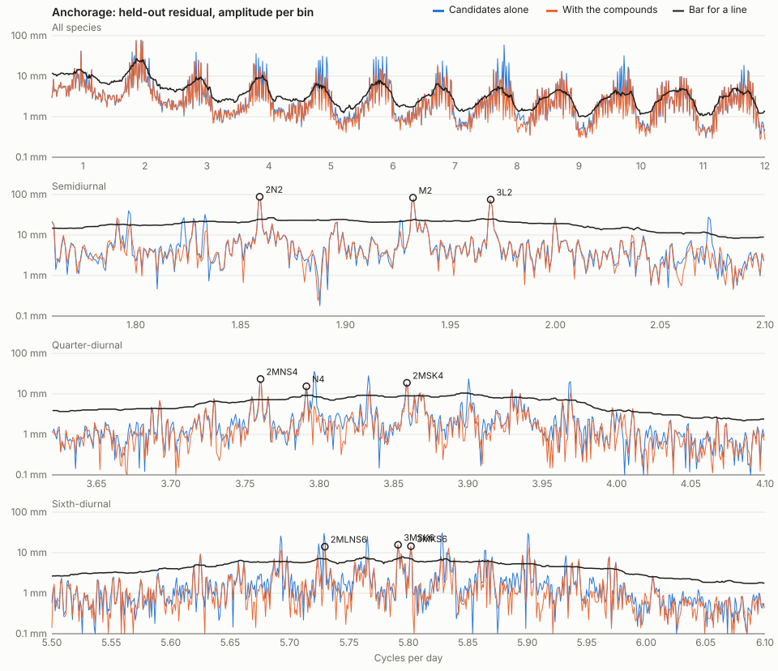
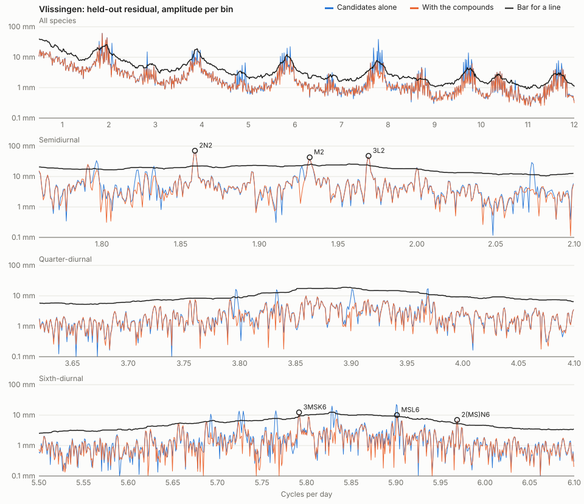
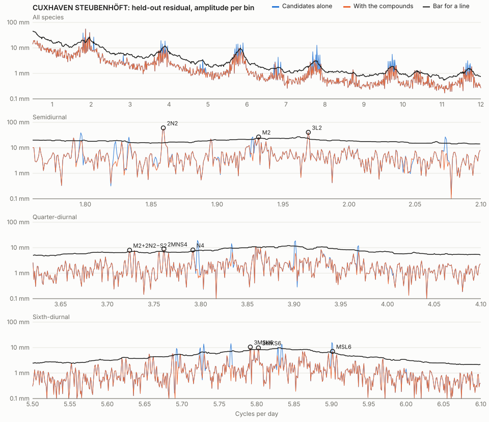
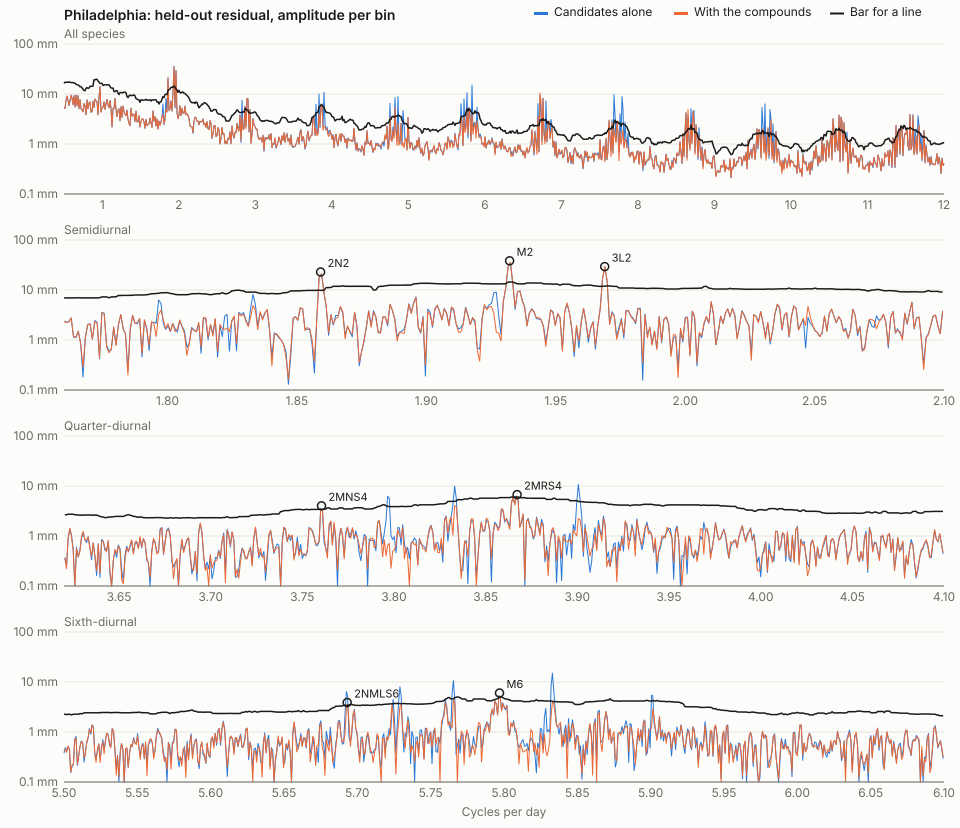
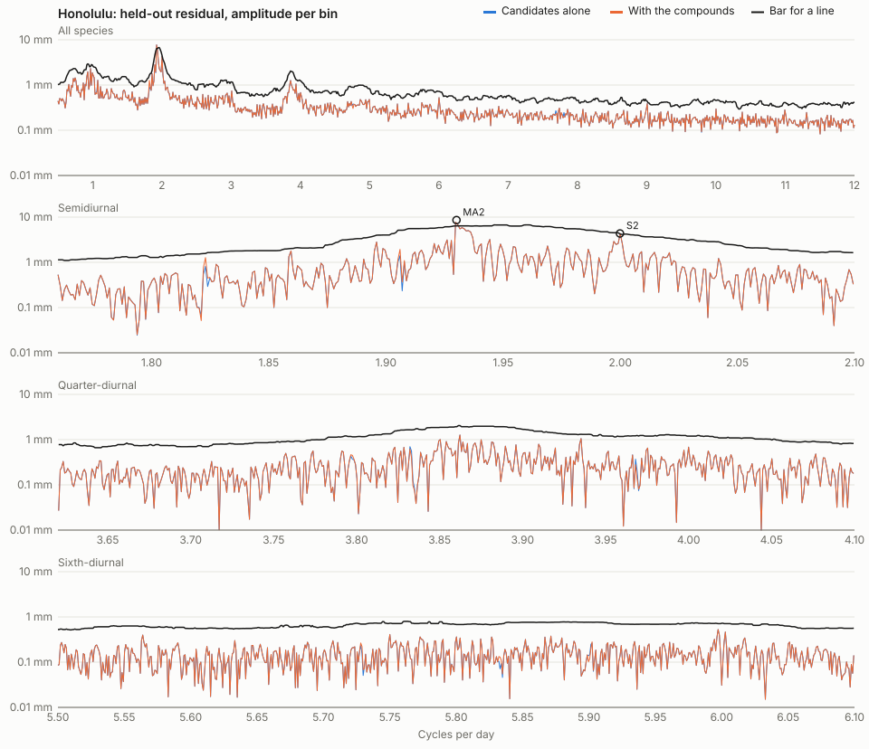
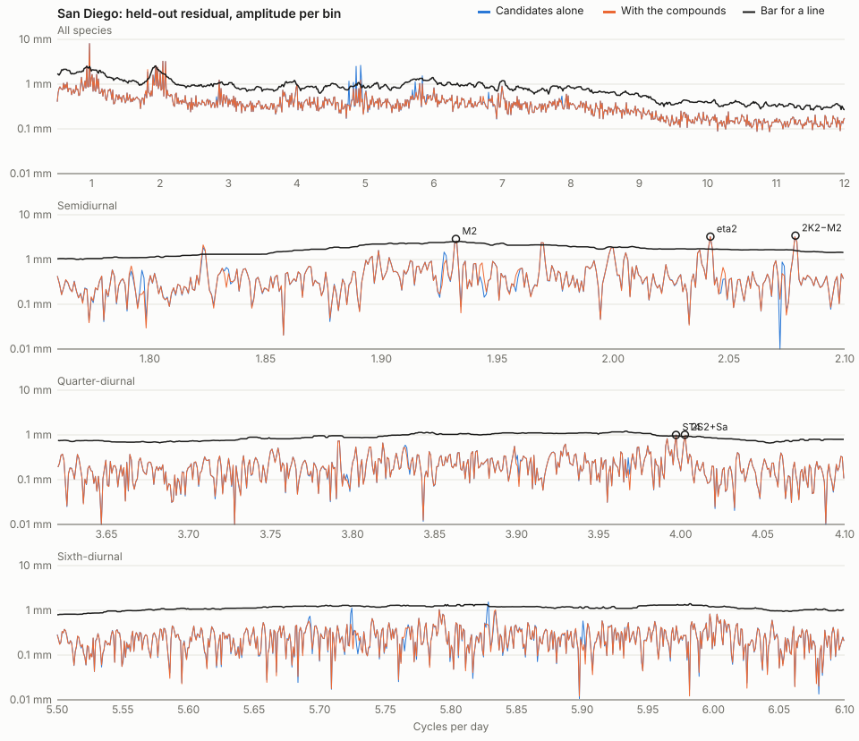

# Residual spectra

Whether the spectrum of a fit's residual tells which gauges need shallow-water compounds, and what the residual holds once they are fitted. Written by `scripts/residual-spectra.ts`; the figures and every number come from that run. It measures and proposes no list or rule.

Engine @slackwater/engine@1.0.0-beta.15, fit method 1, schureman nodal corrections. 56 gauges: 20 of NOAA Center for Operational Oceanographic Products and Services (CO-OPS) (U.S. Government work, public domain), held out 2023 to 2025; 24 of Kartverket (Norwegian Mapping Authority), Hydrographic Service (Creative Commons Attribution 4.0 International), held out 2022 to 2024; 7 of Rijkswaterstaat (CC0 1.0), held out 2022 to 2024; 5 of PEGELONLINE (Wasserstraßen- und Schifffahrtsverwaltung des Bundes) (Datenlizenz Deutschland – Zero – Version 2.0), held out 2022 to 2024.

## Method

**Fits.** Each gauge is fitted over the 2, 5, 19 years before the 3 that end with its source's last year of final values, once with the 79 candidates and once with NOAA's 59 Anchorage compounds offered after them. Selection and the robust fit are the store's, but for Sa and Ssa, which every fit here holds and the store's keeps only where their yearly spread allows. The residuals have the slow part filtered out, so the two don't enter them; they are in the counts of constituents kept and not in the "fitted tide". A window is fitted where the store holds two thirds of its hours, and a gauge where a third of its held-out hours can be scored.

**Residual.** Each fit's constants predict the 3 held-out years, which no fit read. The residual is observed minus predicted on the hour, with the slow part taken out by the Godin filter the fits' own scores use. An hour counts where the 71 hours around it all have values. The gain from the compounds is the difference of the two fits' residual RMS over those hours, and a gauge gains at 1 mm or more.

**Spectrum.** The 3 years are one series of 26,304 hours under a Hann taper, with missing hours given no weight, transformed at its own frequencies without padding. One bin is 0.0137°/h, a third of a cycle per year. Under the taper a line fills three bins, and a peak within two bins of a stronger one counts as part of it, so two lines show apart from three bins, 0.041°/h. That separates lines a cycle per year apart (0.041°/h), such as S2 from T2 and M2 from MA2. It does not separate lines that differ by the perigee's 8.85-year cycle (0.005°/h) or the node's 18.6 (0.002°/h), nor a K2 + N2 product from an M2 + L2 product (0.009°/h), nor two names on one frequency such as L2 and 2MN2. One held-out year alone gives bins of 0.041°/h, and then S2, T2, R2 and K2 fall in one peak, as do K1, S1 and P1, and M2 with MA2 and MB2.

**Fit resolution.** The fits themselves separate lines one cycle apart over their window: 0.0205°/h over 2 years, 0.0082°/h over 5 years, 0.0022°/h over 19 years.

**Continuum.** The running median of the power over 44 bins either side (0.04 cycles per day), divided by ln 2. A line occupies 3 of the 89 bins, so it barely moves the median, and a rise as broad as the window is followed as continuum. One year's spectrum has a third of the bins, and its window is 30 bins either side, 0.08 cycles per day.

**The bar for a line.** A spectrum has 12,603 bins from 0.5 cycles per day to the Nyquist frequency, and every one is examined. A line is a bin whose power is 15.3 times the continuum or more, the level any bin of a spectrum of white noise exceeds in 5% of 300 simulated series put through the same taper, continuum and bins. With the continuum known exactly the level would be ln(12603/0.05) = 12.4; the median's own scatter raises it. So a gauge with no line at all shows one in about one spectrum in twenty. For comparison, the 99.5th percentile of a single bin, the level Boesch and Müller-Navarra (2019) hold a periodogram to, is 5.5 here, and noise alone puts 63 bins over it. For one year's spectrum (4,196 bins) the bar is 13.4.

**Lines.** Peaks over the bar, strongest first. One within two bins of a stronger line is part of it. One that the stronger lines could have leaked, through the taper and the record's gaps, at a quarter of its power or more is dropped. Frequency and amplitude are interpolated between the peak's two largest bins.

**Names.** A peak takes the name of the nearest line in the engine's catalog within one bin, else the combination of fewest terms among sums and differences of M2, S2, N2, K2, K1 and O1 with up to two cycles per year either side, of up to 8 terms. Apart from the name, a peak is "beside a fitted constituent" where one the fit holds lies within a bin. 4% of all bins lie within a bin of a catalog line and 48% within a bin of a catalog or built line, so a built name alone is weak evidence that a peak is that compound.

**Species.** Species n is the band from n − 0.5 to n + 0.5 cycles per day; the twelfth stops at the Nyquist frequency. Its floor runs between the continuum's levels at the two edges, where no tide lies. The rise is the continuum's energy above that floor: a broad rise around the lines with the lines themselves left out. Line energy is half the sum of the lines' squared amplitudes. Where the continuum bends between the edges, as it does in the diurnal band and in the odd species beside a strong even one, the straight floor lies above it and the rise reads zero. Energies are given as their square roots, in millimeters.

## Does the residual tell which gauges gain

### Fits of 19 years

18 gauges gain 1 mm or more from the compounds and 37 don't. Each measure is read from the fit of the candidates alone. The cut is the one with the fewest gauges on the wrong side. "Wrong when left out" sorts each gauge by the cut the other gauges set.

| Measure | AUC | Rank correlation with gain | Cut | Gaining gauges above it | Missed | False alarms | Wrong when left out |
| --- | --- | --- | --- | --- | --- | --- | --- |
| Line energy, third-diurnal and up | 1.00 | 0.97 | 10.2 mm | 18 of 18 | none | none | 2 |
| Line energy, semidiurnal | 0.93 | 0.77 | 15.8 mm | 16 of 18 | Narvik; Stavanger | none | 3 |
| Line energy, diurnal | 0.31 | -0.26 | 28.5 mm | 1 of 18 | Eastport; Boston; Philadelphia; Narvik; Stavanger; Vlissingen; Rilland, Bath; Hoek van Holland; IJmuiden, buitenhaven; Den Helder, Marsdiep; Harlingen, Waddenzee; Delfzijl; BORKUM FISCHERBALJE; HELGOLAND BINNENHAFEN; CUXHAVEN STEUBENHÖFT; HUSUM; HAMBURG ST. PAULI | none | 17 |
| Line energy, all species | 0.98 | 0.89 | 21.5 mm | 16 of 18 | Narvik; Stavanger | none | 4 |
| Lines, third-diurnal and up | 0.95 | 0.83 | 29 lines | 15 of 18 | Boston; Narvik; HUSUM | Friday Harbor; Tromsø | 6 |
| Energy over the floor, third-diurnal and up | 0.98 | 0.91 | 16.4 mm | 16 of 18 | Boston; Stavanger | none | 4 |
| Rise without lines, third-diurnal and up | 0.96 | 0.84 | 15.5 mm | 15 of 18 | Eastport; Boston; Stavanger | none | 3 |
| All energy, third-diurnal and up | 0.98 | 0.82 | 28.0 mm | 15 of 18 | Eastport; Boston; Stavanger | The Battery | 8 |
| Energy over the floor's, third-diurnal and up | 0.94 | 0.83 | 2.40 ratio | 13 of 18 | Boston; Narvik; Stavanger; HELGOLAND BINNENHAFEN; HUSUM | Friday Harbor | 10 |
| Line energy beside no fitted constituent, third-diurnal and up | 1.00 | 0.97 | 9.8 mm | 18 of 18 | none | none | 0 |
| Gain if every line were removed | 0.98 | 0.82 | 3.9 mm | 16 of 18 | Narvik; Stavanger | Friday Harbor | 4 |
| Gain if the lines third-diurnal and up were removed | 1.00 | 0.95 | 0.9 mm | 18 of 18 | none | Tromsø | 2 |
| Gain if the lines beside no fitted constituent were removed | 1.00 | 0.96 | 1.0 mm | 18 of 18 | none | Tromsø | 2 |
| Fitted amplitudes, third-diurnal and up | 0.99 | 0.93 | 42.8 mm | 16 of 18 | Boston; Stavanger | Trondheim | 7 |
| M4 over M2 | 0.83 | 0.58 | 0.0516 ratio | 16 of 18 | Eastport; Boston | Baltimore; Key West; Pensacola; Grand Isle; Helgeroa; Oscarsborg; Oslo; Trondheim; Viker | 15 |
| Fitted tide | 0.87 | 0.65 | 772.4 mm | 12 of 18 | Philadelphia; Stavanger; Hoek van Holland; IJmuiden, buitenhaven; Den Helder, Marsdiep; Harlingen, Waddenzee | Vardø | 8 |
| Residual | 0.96 | 0.81 | 78.5 mm | 15 of 18 | Boston; Narvik; Stavanger | none | 4 |

### Fits of 5 years

17 gauges gain 1 mm or more from the compounds and 39 don't. Each measure is read from the fit of the candidates alone. The cut is the one with the fewest gauges on the wrong side. "Wrong when left out" sorts each gauge by the cut the other gauges set.

| Measure | AUC | Rank correlation with gain | Cut | Gaining gauges above it | Missed | False alarms | Wrong when left out |
| --- | --- | --- | --- | --- | --- | --- | --- |
| Line energy, third-diurnal and up | 0.99 | 0.96 | 9.8 mm | 17 of 17 | none | Boston; Charleston | 4 |
| Line energy, semidiurnal | 0.92 | 0.74 | 27.9 mm | 15 of 17 | Narvik; Stavanger | none | 4 |
| Line energy, diurnal | 0.29 | -0.26 | 31.8 mm | 1 of 17 | Eastport; Philadelphia; Narvik; Stavanger; Vlissingen; Rilland, Bath; Hoek van Holland; IJmuiden, buitenhaven; Den Helder, Marsdiep; Harlingen, Waddenzee; Delfzijl; BORKUM FISCHERBALJE; HELGOLAND BINNENHAFEN; CUXHAVEN STEUBENHÖFT; HUSUM; HAMBURG ST. PAULI | none | 16 |
| Line energy, all species | 0.97 | 0.85 | 37.2 mm | 15 of 17 | Narvik; Stavanger | none | 2 |
| Lines, third-diurnal and up | 0.96 | 0.83 | 27.5 lines | 15 of 17 | Narvik; HUSUM | Friday Harbor; Harstad; Tromsø | 6 |
| Energy over the floor, third-diurnal and up | 0.99 | 0.91 | 16.2 mm | 16 of 17 | Stavanger | Trondheim | 4 |
| Rise without lines, third-diurnal and up | 0.97 | 0.84 | 15.5 mm | 15 of 17 | Eastport; Stavanger | none | 2 |
| All energy, third-diurnal and up | 0.98 | 0.81 | 28.1 mm | 15 of 17 | Eastport; Stavanger | The Battery | 4 |
| Energy over the floor's, third-diurnal and up | 0.97 | 0.84 | 2.40 ratio | 13 of 17 | Narvik; Stavanger; HELGOLAND BINNENHAFEN; HUSUM | Friday Harbor | 9 |
| Line energy beside no fitted constituent, third-diurnal and up | 1.00 | 0.97 | 9.8 mm | 17 of 17 | none | Boston | 2 |
| Gain if every line were removed | 0.96 | 0.74 | 9.0 mm | 15 of 17 | Narvik; Stavanger | none | 2 |
| Gain if the lines third-diurnal and up were removed | 0.99 | 0.94 | 1.2 mm | 15 of 17 | Narvik; HELGOLAND BINNENHAFEN | none | 5 |
| Gain if the lines beside no fitted constituent were removed | 1.00 | 0.96 | 1.0 mm | 17 of 17 | none | Tromsø | 3 |
| Fitted amplitudes, third-diurnal and up | 0.99 | 0.93 | 43.2 mm | 16 of 17 | Stavanger | Trondheim | 3 |
| M4 over M2 | 0.86 | 0.59 | 0.0621 ratio | 13 of 17 | Eastport; Narvik; Stavanger; Rilland, Bath | Pensacola; Grand Isle; Helgeroa; Oscarsborg; Oslo; Viker | 10 |
| Fitted tide | 0.85 | 0.64 | 772.4 mm | 11 of 17 | Philadelphia; Stavanger; Hoek van Holland; IJmuiden, buitenhaven; Den Helder, Marsdiep; Harlingen, Waddenzee | Boston; Vardø | 9 |
| Residual | 0.97 | 0.81 | 81.1 mm | 15 of 17 | Narvik; Stavanger | none | 3 |

### Fits of 2 years

16 gauges gain 1 mm or more from the compounds and 40 don't. Each measure is read from the fit of the candidates alone. The cut is the one with the fewest gauges on the wrong side. "Wrong when left out" sorts each gauge by the cut the other gauges set.

| Measure | AUC | Rank correlation with gain | Cut | Gaining gauges above it | Missed | False alarms | Wrong when left out |
| --- | --- | --- | --- | --- | --- | --- | --- |
| Line energy, third-diurnal and up | 1.00 | 0.97 | 10.8 mm | 16 of 16 | none | Boston | 3 |
| Line energy, semidiurnal | 0.96 | 0.71 | 33.9 mm | 15 of 16 | Stavanger | none | 3 |
| Line energy, diurnal | 0.79 | 0.37 | 10.9 mm | 12 of 16 | Eastport; Stavanger; Rilland, Bath; HUSUM | Pensacola; South Beach; Friday Harbor | 7 |
| Line energy, all species | 0.97 | 0.78 | 42.9 mm | 15 of 16 | Stavanger | none | 1 |
| Lines, third-diurnal and up | 0.96 | 0.83 | 31.5 lines | 14 of 16 | Rilland, Bath; HUSUM | Friday Harbor; Tromsø | 4 |
| Energy over the floor, third-diurnal and up | 0.99 | 0.92 | 23.3 mm | 14 of 16 | Eastport; Stavanger | none | 5 |
| Rise without lines, third-diurnal and up | 0.96 | 0.84 | 15.6 mm | 14 of 16 | Eastport; Stavanger | Narvik | 4 |
| All energy, third-diurnal and up | 0.98 | 0.82 | 34.6 mm | 14 of 16 | Eastport; Stavanger | none | 4 |
| Energy over the floor's, third-diurnal and up | 0.97 | 0.83 | 2.40 ratio | 13 of 16 | Stavanger; HELGOLAND BINNENHAFEN; HUSUM | Friday Harbor | 7 |
| Line energy beside no fitted constituent, third-diurnal and up | 1.00 | 0.97 | 10.9 mm | 16 of 16 | none | none | 2 |
| Gain if every line were removed | 0.98 | 0.70 | 12.0 mm | 15 of 16 | Stavanger | none | 1 |
| Gain if the lines third-diurnal and up were removed | 1.00 | 0.94 | 1.1 mm | 16 of 16 | none | none | 1 |
| Gain if the lines beside no fitted constituent were removed | 1.00 | 0.96 | 1.3 mm | 16 of 16 | none | none | 0 |
| Fitted amplitudes, third-diurnal and up | 0.99 | 0.91 | 59.1 mm | 15 of 16 | Stavanger | none | 1 |
| M4 over M2 | 0.86 | 0.60 | 0.0634 ratio | 13 of 16 | Eastport; Stavanger; Rilland, Bath | Pensacola; Grand Isle; Helgeroa; Oscarsborg; Oslo; Viker | 9 |
| Fitted tide | 0.84 | 0.62 | 810.4 mm | 10 of 16 | Philadelphia; Stavanger; Hoek van Holland; IJmuiden, buitenhaven; Den Helder, Marsdiep; Harlingen, Waddenzee | Boston | 7 |
| Residual | 0.97 | 0.81 | 84.8 mm | 15 of 16 | Stavanger | none | 2 |

### The 19-year cuts on shorter fits

Each measure's cut from the 19-year fits, applied to the same measure from the shorter fits and scored on the shorter fits' own gains.

| Measure | Fit | Gaining gauges above the cut | Missed | False alarms |
| --- | --- | --- | --- | --- |
| Line energy, third-diurnal and up | 2 years | 16 of 16 | none | Boston; Charleston; Narvik |
| Line energy, third-diurnal and up | 5 years | 17 of 17 | none | Boston; Charleston |
| Line energy, semidiurnal | 2 years | 15 of 16 | Stavanger | Boston |
| Line energy, semidiurnal | 5 years | 15 of 17 | Narvik; Stavanger | Boston |
| Line energy, diurnal | 2 years | 1 of 16 | Eastport; Philadelphia; Stavanger; Vlissingen; Rilland, Bath; Hoek van Holland; IJmuiden, buitenhaven; Den Helder, Marsdiep; Harlingen, Waddenzee; Delfzijl; BORKUM FISCHERBALJE; HELGOLAND BINNENHAFEN; CUXHAVEN STEUBENHÖFT; HUSUM; HAMBURG ST. PAULI | none |
| Line energy, diurnal | 5 years | 1 of 17 | Eastport; Philadelphia; Narvik; Stavanger; Vlissingen; Rilland, Bath; Hoek van Holland; IJmuiden, buitenhaven; Den Helder, Marsdiep; Harlingen, Waddenzee; Delfzijl; BORKUM FISCHERBALJE; HELGOLAND BINNENHAFEN; CUXHAVEN STEUBENHÖFT; HUSUM; HAMBURG ST. PAULI | none |
| Line energy, all species | 2 years | 15 of 16 | Stavanger | Boston; Friday Harbor |
| Line energy, all species | 5 years | 15 of 17 | Narvik; Stavanger | Boston; Friday Harbor |
| Lines, third-diurnal and up | 2 years | 14 of 16 | Rilland, Bath; HUSUM | Friday Harbor; Tromsø |
| Lines, third-diurnal and up | 5 years | 14 of 17 | Narvik; Rilland, Bath; HUSUM | Friday Harbor; Tromsø |
| Energy over the floor, third-diurnal and up | 2 years | 15 of 16 | Stavanger | Narvik; Trondheim |
| Energy over the floor, third-diurnal and up | 5 years | 16 of 17 | Stavanger | Trondheim |
| Rise without lines, third-diurnal and up | 2 years | 14 of 16 | Eastport; Stavanger | Narvik |
| Rise without lines, third-diurnal and up | 5 years | 15 of 17 | Eastport; Stavanger | none |
| All energy, third-diurnal and up | 2 years | 14 of 16 | Eastport; Stavanger | The Battery; Narvik |
| All energy, third-diurnal and up | 5 years | 15 of 17 | Eastport; Stavanger | The Battery |
| Energy over the floor's, third-diurnal and up | 2 years | 13 of 16 | Stavanger; HELGOLAND BINNENHAFEN; HUSUM | Friday Harbor |
| Energy over the floor's, third-diurnal and up | 5 years | 13 of 17 | Narvik; Stavanger; HELGOLAND BINNENHAFEN; HUSUM | Friday Harbor |
| Line energy beside no fitted constituent, third-diurnal and up | 2 years | 16 of 16 | none | Boston; Narvik |
| Line energy beside no fitted constituent, third-diurnal and up | 5 years | 17 of 17 | none | Boston |
| Gain if every line were removed | 2 years | 15 of 16 | Stavanger | Honolulu; Pago Pago, American Samoa; Boston; San Diego; South Beach; Friday Harbor; Tromsø |
| Gain if every line were removed | 5 years | 15 of 17 | Narvik; Stavanger | Boston; South Beach; Friday Harbor |
| Gain if the lines third-diurnal and up were removed | 2 years | 16 of 16 | none | Boston; Charleston; Narvik; Tromsø |
| Gain if the lines third-diurnal and up were removed | 5 years | 17 of 17 | none | Boston; Charleston; Tromsø |
| Gain if the lines beside no fitted constituent were removed | 2 years | 16 of 16 | none | Boston; Narvik; Tromsø |
| Gain if the lines beside no fitted constituent were removed | 5 years | 17 of 17 | none | Tromsø |
| Fitted amplitudes, third-diurnal and up | 2 years | 15 of 16 | Stavanger | Narvik; Trondheim |
| Fitted amplitudes, third-diurnal and up | 5 years | 16 of 17 | Stavanger | Trondheim |
| M4 over M2 | 2 years | 13 of 16 | Eastport; Stavanger; Rilland, Bath | Baltimore; Charleston; Key West; Pensacola; Grand Isle; Galveston Pier 21; Helgeroa; Narvik; Oscarsborg; Oslo; Trondheim; Viker |
| M4 over M2 | 5 years | 14 of 17 | Eastport; Stavanger; Rilland, Bath | Baltimore; Key West; Pensacola; Grand Isle; Galveston Pier 21; Helgeroa; Oscarsborg; Oslo; Trondheim; Viker |
| Fitted tide | 2 years | 10 of 16 | Philadelphia; Stavanger; Hoek van Holland; IJmuiden, buitenhaven; Den Helder, Marsdiep; Harlingen, Waddenzee | Boston; Narvik; Vardø |
| Fitted tide | 5 years | 11 of 17 | Philadelphia; Stavanger; Hoek van Holland; IJmuiden, buitenhaven; Den Helder, Marsdiep; Harlingen, Waddenzee | Boston; Vardø |
| Residual | 2 years | 15 of 16 | Stavanger | Oslo |
| Residual | 5 years | 15 of 17 | Narvik; Stavanger | none |

### One source sorted by the others' cut

The 19-year fits. Each source's gauges are sorted by the cut the other sources' gauges set, so a cut that only describes one coast shows.

| Measure | NOAA Center for Operational Oceanographic Products and Services | Kartverket | Rijkswaterstaat | PEGELONLINE |
| --- | --- | --- | --- | --- |
| Line energy, third-diurnal and up | 1 wrong of 20 (4 gaining) | 1 wrong of 23 (2 gaining) | 0 wrong of 7 (7 gaining) | 0 wrong of 5 (5 gaining) |
| Line energy, semidiurnal | 1 wrong of 20 (4 gaining) | 2 wrong of 23 (2 gaining) | 0 wrong of 7 (7 gaining) | 0 wrong of 5 (5 gaining) |
| Line energy, diurnal | 9 wrong of 20 (4 gaining) | 2 wrong of 23 (2 gaining) | 7 wrong of 7 (7 gaining) | 5 wrong of 5 (5 gaining) |
| Line energy, all species | 1 wrong of 20 (4 gaining) | 2 wrong of 23 (2 gaining) | 0 wrong of 7 (7 gaining) | 0 wrong of 5 (5 gaining) |
| Lines, third-diurnal and up | 2 wrong of 20 (4 gaining) | 11 wrong of 23 (2 gaining) | 1 wrong of 7 (7 gaining) | 1 wrong of 5 (5 gaining) |
| Energy over the floor, third-diurnal and up | 2 wrong of 20 (4 gaining) | 3 wrong of 23 (2 gaining) | 0 wrong of 7 (7 gaining) | 0 wrong of 5 (5 gaining) |
| Rise without lines, third-diurnal and up | 2 wrong of 20 (4 gaining) | 8 wrong of 23 (2 gaining) | 0 wrong of 7 (7 gaining) | 0 wrong of 5 (5 gaining) |
| All energy, third-diurnal and up | 3 wrong of 20 (4 gaining) | 3 wrong of 23 (2 gaining) | 0 wrong of 7 (7 gaining) | 0 wrong of 5 (5 gaining) |
| Energy over the floor's, third-diurnal and up | 3 wrong of 20 (4 gaining) | 5 wrong of 23 (2 gaining) | 0 wrong of 7 (7 gaining) | 2 wrong of 5 (5 gaining) |
| Line energy beside no fitted constituent, third-diurnal and up | 0 wrong of 20 (4 gaining) | 0 wrong of 23 (2 gaining) | 0 wrong of 7 (7 gaining) | 0 wrong of 5 (5 gaining) |
| Gain if every line were removed | 4 wrong of 20 (4 gaining) | 2 wrong of 23 (2 gaining) | 0 wrong of 7 (7 gaining) | 0 wrong of 5 (5 gaining) |
| Gain if the lines third-diurnal and up were removed | 2 wrong of 20 (4 gaining) | 2 wrong of 23 (2 gaining) | 0 wrong of 7 (7 gaining) | 0 wrong of 5 (5 gaining) |
| Gain if the lines beside no fitted constituent were removed | 1 wrong of 20 (4 gaining) | 1 wrong of 23 (2 gaining) | 0 wrong of 7 (7 gaining) | 0 wrong of 5 (5 gaining) |
| Fitted amplitudes, third-diurnal and up | 2 wrong of 20 (4 gaining) | 3 wrong of 23 (2 gaining) | 0 wrong of 7 (7 gaining) | 0 wrong of 5 (5 gaining) |
| M4 over M2 | 9 wrong of 20 (4 gaining) | 7 wrong of 23 (2 gaining) | 1 wrong of 7 (7 gaining) | 0 wrong of 5 (5 gaining) |
| Fitted tide | 3 wrong of 20 (4 gaining) | 13 wrong of 23 (2 gaining) | 4 wrong of 7 (7 gaining) | 0 wrong of 5 (5 gaining) |
| Residual | 3 wrong of 20 (4 gaining) | 2 wrong of 23 (2 gaining) | 0 wrong of 7 (7 gaining) | 0 wrong of 5 (5 gaining) |

### Another gain to count as gaining

At 0.5 mm, 28 gauges gain.

| Measure | AUC | Rank correlation with gain | Cut | Gaining gauges above it | Missed | False alarms | Wrong when left out |
| --- | --- | --- | --- | --- | --- | --- | --- |
| Line energy, third-diurnal and up | 0.98 | 0.97 | 5.2 mm | 26 of 28 | Oscarsborg; Viker | Kabelvåg | 5 |
| Line energy, semidiurnal | 0.87 | 0.77 | 8.0 mm | 22 of 28 | The Battery; Charleston; Bergen; Narvik; Stavanger; Trondheim | Helgeroa | 9 |
| Line energy, diurnal | 0.36 | -0.26 | 7.9 mm | 3 of 28 | Eastport; Boston; The Battery; Philadelphia; Charleston; Bergen; Narvik; Oscarsborg; Oslo; Stavanger; Tromsø; Trondheim; Viker; Vlissingen; Rilland, Bath; Hoek van Holland; IJmuiden, buitenhaven; Den Helder, Marsdiep; Harlingen, Waddenzee; Delfzijl; BORKUM FISCHERBALJE; HELGOLAND BINNENHAFEN; CUXHAVEN STEUBENHÖFT; HUSUM; HAMBURG ST. PAULI | Pensacola | 27 |
| Line energy, all species | 0.96 | 0.89 | 10.1 mm | 25 of 28 | The Battery; Bergen; Trondheim | Pensacola | 8 |
| Lines, third-diurnal and up | 0.89 | 0.83 | 24 lines | 22 of 28 | Charleston; Oscarsborg; Oslo; Trondheim; Viker; HUSUM | Ålesund; Harstad; Hammerfest; Honningsvåg | 15 |
| Energy over the floor, third-diurnal and up | 0.98 | 0.91 | 7.2 mm | 28 of 28 | none | Bodø; Heimsjøen; Kabelvåg | 4 |
| Rise without lines, third-diurnal and up | 0.95 | 0.84 | 6.0 mm | 25 of 28 | South Beach; Friday Harbor; Tromsø | Bodø; Heimsjøen; Kabelvåg | 10 |
| All energy, third-diurnal and up | 0.96 | 0.82 | 14.2 mm | 25 of 28 | South Beach; Friday Harbor; Tromsø | Galveston Pier 21; Kabelvåg | 6 |
| Energy over the floor's, third-diurnal and up | 0.89 | 0.83 | 1.71 ratio | 21 of 28 | Boston; The Battery; Charleston; Bergen; Oscarsborg; Oslo; Viker | Bodø; Harstad; Kabelvåg | 13 |
| Line energy beside no fitted constituent, third-diurnal and up | 0.98 | 0.97 | 5.2 mm | 26 of 28 | Oscarsborg; Viker | Kabelvåg | 5 |
| Gain if every line were removed | 0.91 | 0.82 | 1.1 mm | 22 of 28 | The Battery; Bergen; Narvik; Oscarsborg; Trondheim; Viker | Pensacola; San Diego; Vardø | 12 |
| Gain if the lines third-diurnal and up were removed | 0.96 | 0.95 | 0.3 mm | 25 of 28 | Oscarsborg; Oslo; Viker | San Diego | 5 |
| Gain if the lines beside no fitted constituent were removed | 0.98 | 0.96 | 0.3 mm | 28 of 28 | none | Pensacola; San Diego; Harstad; Hammerfest; Kabelvåg | 10 |
| Fitted amplitudes, third-diurnal and up | 0.97 | 0.93 | 13.5 mm | 27 of 28 | Bergen | Bodø; Heimsjøen; Kabelvåg; Rørvik; Vardø | 11 |
| M4 over M2 | 0.83 | 0.58 | 0.0144 ratio | 27 of 28 | Tromsø | Baltimore; Key West; Pensacola; Grand Isle; Galveston Pier 21; Charlotte Amalie; Bodø; Heimsjøen; Helgeroa; Kabelvåg; Kristiansund; Rørvik | 20 |
| Fitted tide | 0.78 | 0.65 | 543.0 mm | 21 of 28 | The Battery; Bergen; Oscarsborg; Oslo; Stavanger; Viker; Den Helder, Marsdiep | Bodø; Heimsjøen; Hammerfest; Honningsvåg; Kabelvåg; Rørvik; Vardø | 17 |
| Residual | 0.90 | 0.81 | 57.1 mm | 22 of 28 | South Beach; Friday Harbor; Bergen; Stavanger; Tromsø; Trondheim | Baltimore; Helgeroa | 9 |

At 2.0 mm, 14 gauges gain.

| Measure | AUC | Rank correlation with gain | Cut | Gaining gauges above it | Missed | False alarms | Wrong when left out |
| --- | --- | --- | --- | --- | --- | --- | --- |
| Line energy, third-diurnal and up | 1.00 | 0.97 | 16.3 mm | 14 of 14 | none | none | 2 |
| Line energy, semidiurnal | 0.99 | 0.77 | 28.9 mm | 14 of 14 | none | Eastport | 1 |
| Line energy, diurnal | 0.34 | -0.26 | 28.5 mm | 1 of 14 | Philadelphia; Vlissingen; Rilland, Bath; Hoek van Holland; IJmuiden, buitenhaven; Den Helder, Marsdiep; Harlingen, Waddenzee; Delfzijl; BORKUM FISCHERBALJE; HELGOLAND BINNENHAFEN; CUXHAVEN STEUBENHÖFT; HUSUM; HAMBURG ST. PAULI | none | 13 |
| Line energy, all species | 1.00 | 0.89 | 51.3 mm | 14 of 14 | none | none | 2 |
| Lines, third-diurnal and up | 0.95 | 0.83 | 29 lines | 13 of 14 | HUSUM | Eastport; Friday Harbor; Stavanger; Tromsø | 6 |
| Energy over the floor, third-diurnal and up | 1.00 | 0.91 | 22.8 mm | 14 of 14 | none | none | 2 |
| Rise without lines, third-diurnal and up | 1.00 | 0.84 | 15.5 mm | 14 of 14 | none | Narvik | 2 |
| All energy, third-diurnal and up | 1.00 | 0.82 | 34.4 mm | 14 of 14 | none | none | 2 |
| Energy over the floor's, third-diurnal and up | 0.98 | 0.83 | 2.57 ratio | 12 of 14 | HELGOLAND BINNENHAFEN; HUSUM | Friday Harbor | 5 |
| Line energy beside no fitted constituent, third-diurnal and up | 1.00 | 0.97 | 16.0 mm | 14 of 14 | none | none | 2 |
| Gain if every line were removed | 0.99 | 0.82 | 7.4 mm | 14 of 14 | none | Eastport | 1 |
| Gain if the lines third-diurnal and up were removed | 0.99 | 0.95 | 2.1 mm | 13 of 14 | HELGOLAND BINNENHAFEN | none | 2 |
| Gain if the lines beside no fitted constituent were removed | 1.00 | 0.96 | 2.9 mm | 14 of 14 | none | none | 0 |
| Fitted amplitudes, third-diurnal and up | 1.00 | 0.93 | 66.0 mm | 14 of 14 | none | none | 2 |
| M4 over M2 | 0.90 | 0.58 | 0.0620 ratio | 13 of 14 | Rilland, Bath | Pensacola; Grand Isle; Helgeroa; Oscarsborg; Oslo; Viker | 8 |
| Fitted tide | 0.86 | 0.65 | 807.9 mm | 9 of 14 | Philadelphia; Hoek van Holland; IJmuiden, buitenhaven; Den Helder, Marsdiep; Harlingen, Waddenzee | Eastport; Boston | 7 |
| Residual | 1.00 | 0.81 | 91.4 mm | 14 of 14 | none | none | 1 |

### One year's spectrum against the later years' gain

The measure and the gain above come from the same 3 years, so a line in those years counts toward both. Here each measure is read from a gauge's first held-out year with half its hours, alone, at a third of the resolution, and sorts the gain over the years after it. A gauge with one such year is left out.

**Fits of 19 years.**

| Measure | AUC | Rank correlation with gain | Cut | Gaining gauges above it | Missed | False alarms | Wrong when left out |
| --- | --- | --- | --- | --- | --- | --- | --- |
| Line energy, third-diurnal and up | 1.00 | 0.96 | 9.2 mm | 17 of 17 | none | Boston | 2 |
| Line energy, semidiurnal | 0.91 | 0.69 | 25.8 mm | 15 of 17 | Narvik; Stavanger | none | 2 |
| Line energy, diurnal | 0.44 | -0.13 | 26.2 mm | 1 of 17 | Eastport; Philadelphia; Narvik; Stavanger; Vlissingen; Rilland, Bath; Hoek van Holland; IJmuiden, buitenhaven; Den Helder, Marsdiep; Harlingen, Waddenzee; Delfzijl; BORKUM FISCHERBALJE; HELGOLAND BINNENHAFEN; CUXHAVEN STEUBENHÖFT; HUSUM; HAMBURG ST. PAULI | none | 16 |
| Line energy, all species | 0.98 | 0.82 | 30.5 mm | 15 of 17 | Narvik; Stavanger | none | 2 |
| Lines, third-diurnal and up | 0.96 | 0.81 | 18.5 lines | 13 of 17 | Narvik; Rilland, Bath; IJmuiden, buitenhaven; HUSUM | none | 6 |
| Energy over the floor, third-diurnal and up | 0.99 | 0.91 | 16.2 mm | 16 of 17 | Stavanger | Charleston | 4 |
| Rise without lines, third-diurnal and up | 0.96 | 0.82 | 13.4 mm | 15 of 17 | Eastport; Stavanger | Charleston | 4 |
| All energy, third-diurnal and up | 0.98 | 0.80 | 23.0 mm | 15 of 17 | Eastport; Stavanger | The Battery; Charleston | 8 |
| Energy over the floor's, third-diurnal and up | 0.98 | 0.87 | 2.92 ratio | 15 of 17 | Narvik; Stavanger | Trondheim | 5 |
| Line energy beside no fitted constituent, third-diurnal and up | 1.00 | 0.95 | 10.2 mm | 17 of 17 | none | none | 2 |
| Gain if every line were removed | 0.97 | 0.75 | 6.5 mm | 15 of 17 | Narvik; Stavanger | none | 3 |
| Gain if the lines third-diurnal and up were removed | 1.00 | 0.94 | 0.9 mm | 17 of 17 | none | Boston | 3 |
| Gain if the lines beside no fitted constituent were removed | 1.00 | 0.89 | 0.9 mm | 17 of 17 | none | South Beach | 3 |
| Fitted amplitudes, third-diurnal and up | 0.99 | 0.93 | 42.8 mm | 16 of 17 | Stavanger | Trondheim | 3 |
| M4 over M2 | 0.86 | 0.59 | 0.0516 ratio | 16 of 17 | Eastport | Baltimore; Key West; Pensacola; Grand Isle; Helgeroa; Oscarsborg; Oslo; Trondheim; Viker | 14 |
| Fitted tide | 0.85 | 0.64 | 772.4 mm | 11 of 17 | Philadelphia; Stavanger; Hoek van Holland; IJmuiden, buitenhaven; Den Helder, Marsdiep; Harlingen, Waddenzee | Boston; Vardø | 9 |
| Residual | 0.96 | 0.80 | 87.9 mm | 14 of 17 | Eastport; Narvik; Stavanger | none | 6 |

**Fits of 5 years.**

| Measure | AUC | Rank correlation with gain | Cut | Gaining gauges above it | Missed | False alarms | Wrong when left out |
| --- | --- | --- | --- | --- | --- | --- | --- |
| Line energy, third-diurnal and up | 1.00 | 0.94 | 9.2 mm | 17 of 17 | none | Boston | 2 |
| Line energy, semidiurnal | 0.92 | 0.67 | 26.4 mm | 15 of 17 | Narvik; Stavanger | none | 4 |
| Line energy, diurnal | 0.48 | -0.00 | 8.2 mm | 4 of 17 | Eastport; Philadelphia; Narvik; Stavanger; Vlissingen; Rilland, Bath; IJmuiden, buitenhaven; Den Helder, Marsdiep; Harlingen, Waddenzee; Delfzijl; CUXHAVEN STEUBENHÖFT; HUSUM; HAMBURG ST. PAULI | Pensacola; South Beach; Friday Harbor | 19 |
| Line energy, all species | 0.98 | 0.80 | 36.7 mm | 15 of 17 | Narvik; Stavanger | none | 2 |
| Lines, third-diurnal and up | 0.95 | 0.80 | 18 lines | 13 of 17 | Narvik; Rilland, Bath; IJmuiden, buitenhaven; HUSUM | none | 6 |
| Energy over the floor, third-diurnal and up | 0.99 | 0.91 | 16.4 mm | 16 of 17 | Stavanger | Charleston | 4 |
| Rise without lines, third-diurnal and up | 0.96 | 0.82 | 13.6 mm | 15 of 17 | Eastport; Stavanger | Charleston | 4 |
| All energy, third-diurnal and up | 0.98 | 0.80 | 23.2 mm | 15 of 17 | Eastport; Stavanger | The Battery; Charleston | 8 |
| Energy over the floor's, third-diurnal and up | 0.98 | 0.86 | 3.05 ratio | 14 of 17 | Narvik; Stavanger; Rilland, Bath | none | 6 |
| Line energy beside no fitted constituent, third-diurnal and up | 1.00 | 0.95 | 10.3 mm | 17 of 17 | none | none | 2 |
| Gain if every line were removed | 0.97 | 0.73 | 7.9 mm | 15 of 17 | Narvik; Stavanger | none | 3 |
| Gain if the lines third-diurnal and up were removed | 1.00 | 0.94 | 0.9 mm | 17 of 17 | none | none | 1 |
| Gain if the lines beside no fitted constituent were removed | 1.00 | 0.90 | 0.9 mm | 17 of 17 | none | none | 1 |
| Fitted amplitudes, third-diurnal and up | 0.99 | 0.92 | 43.2 mm | 16 of 17 | Stavanger | Trondheim | 3 |
| M4 over M2 | 0.86 | 0.58 | 0.0621 ratio | 13 of 17 | Eastport; Narvik; Stavanger; Rilland, Bath | Pensacola; Grand Isle; Helgeroa; Oscarsborg; Oslo; Viker | 10 |
| Fitted tide | 0.85 | 0.64 | 772.4 mm | 11 of 17 | Philadelphia; Stavanger; Hoek van Holland; IJmuiden, buitenhaven; Den Helder, Marsdiep; Harlingen, Waddenzee | Boston; Vardø | 9 |
| Residual | 0.96 | 0.78 | 80.1 mm | 15 of 17 | Narvik; Stavanger | none | 3 |

**Fits of 2 years.**

| Measure | AUC | Rank correlation with gain | Cut | Gaining gauges above it | Missed | False alarms | Wrong when left out |
| --- | --- | --- | --- | --- | --- | --- | --- |
| Line energy, third-diurnal and up | 1.00 | 0.94 | 10.6 mm | 16 of 16 | none | none | 1 |
| Line energy, semidiurnal | 0.97 | 0.63 | 28.2 mm | 15 of 16 | Stavanger | none | 3 |
| Line energy, diurnal | 0.75 | 0.35 | 9.6 mm | 10 of 16 | Eastport; Philadelphia; Stavanger; CUXHAVEN STEUBENHÖFT; HUSUM; HAMBURG ST. PAULI | Pensacola; South Beach; Friday Harbor | 11 |
| Line energy, all species | 0.99 | 0.74 | 37.9 mm | 15 of 16 | Stavanger | none | 1 |
| Lines, third-diurnal and up | 0.96 | 0.81 | 18 lines | 13 of 16 | Rilland, Bath; IJmuiden, buitenhaven; HUSUM | none | 6 |
| Energy over the floor, third-diurnal and up | 0.99 | 0.91 | 21.7 mm | 14 of 16 | Eastport; Stavanger | none | 3 |
| Rise without lines, third-diurnal and up | 0.96 | 0.81 | 13.7 mm | 14 of 16 | Eastport; Stavanger | Charleston; Narvik | 7 |
| All energy, third-diurnal and up | 0.98 | 0.81 | 28.0 mm | 14 of 16 | Eastport; Stavanger | The Battery | 5 |
| Energy over the floor's, third-diurnal and up | 0.99 | 0.85 | 2.76 ratio | 15 of 16 | Stavanger | Kabelvåg; Trondheim | 6 |
| Line energy beside no fitted constituent, third-diurnal and up | 1.00 | 0.94 | 10.5 mm | 16 of 16 | none | none | 1 |
| Gain if every line were removed | 0.99 | 0.67 | 9.8 mm | 15 of 16 | Stavanger | none | 1 |
| Gain if the lines third-diurnal and up were removed | 1.00 | 0.93 | 1.0 mm | 16 of 16 | none | none | 0 |
| Gain if the lines beside no fitted constituent were removed | 1.00 | 0.88 | 1.2 mm | 16 of 16 | none | none | 1 |
| Fitted amplitudes, third-diurnal and up | 0.99 | 0.90 | 59.1 mm | 15 of 16 | Stavanger | none | 1 |
| M4 over M2 | 0.86 | 0.61 | 0.0634 ratio | 13 of 16 | Eastport; Stavanger; Rilland, Bath | Pensacola; Grand Isle; Helgeroa; Oscarsborg; Oslo; Viker | 9 |
| Fitted tide | 0.84 | 0.60 | 810.4 mm | 10 of 16 | Philadelphia; Stavanger; Hoek van Holland; IJmuiden, buitenhaven; Den Helder, Marsdiep; Harlingen, Waddenzee | Boston | 7 |
| Residual | 0.97 | 0.79 | 83.0 mm | 15 of 16 | Stavanger | none | 2 |

Gauges that fall on different sides of that cut in different held-out years:

| Measure | 19-year fits | 5-year fits | 2-year fits |
| --- | --- | --- | --- |
| Line energy, third-diurnal and up | The Battery; Trondheim | The Battery; Trondheim | Boston; Narvik; Stavanger |
| Line energy, semidiurnal | none | Boston | Boston; Philadelphia; Rilland, Bath |
| Line energy, diurnal | none | Pensacola; Unalaska; Hoek van Holland; BORKUM FISCHERBALJE; HELGOLAND BINNENHAFEN | Pensacola; South Beach; Unalaska; Vardø; Vlissingen; Rilland, Bath; Hoek van Holland; IJmuiden, buitenhaven; Den Helder, Marsdiep; Harlingen, Waddenzee; Delfzijl; BORKUM FISCHERBALJE; HELGOLAND BINNENHAFEN; CUXHAVEN STEUBENHÖFT |
| Line energy, all species | none | none | none |
| Lines, third-diurnal and up | Stavanger; IJmuiden, buitenhaven; HELGOLAND BINNENHAFEN | Stavanger; IJmuiden, buitenhaven; HELGOLAND BINNENHAFEN | Stavanger; IJmuiden, buitenhaven; HELGOLAND BINNENHAFEN |
| Energy over the floor, third-diurnal and up | Eastport; Charleston; Narvik | Eastport; Charleston; Narvik | HELGOLAND BINNENHAFEN |
| Rise without lines, third-diurnal and up | Charleston; Narvik | Charleston; Narvik | Charleston; Narvik; HELGOLAND BINNENHAFEN |
| All energy, third-diurnal and up | none | none | none |
| Energy over the floor's, third-diurnal and up | Eastport; Friday Harbor; Bodø; Kabelvåg; Trondheim; Rilland, Bath; HELGOLAND BINNENHAFEN; HUSUM | Eastport; Friday Harbor; Bodø; Kabelvåg; HELGOLAND BINNENHAFEN; HUSUM | Eastport; Friday Harbor; Bodø; Kabelvåg; Narvik; Trondheim; Rilland, Bath; HELGOLAND BINNENHAFEN; HUSUM |
| Line energy beside no fitted constituent, third-diurnal and up | Boston; Narvik; Stavanger; Trondheim | Boston; Narvik; Stavanger; Trondheim | Boston; Narvik; Stavanger |
| Gain if every line were removed | none | none | Boston; Philadelphia; Rilland, Bath; Den Helder, Marsdiep; HELGOLAND BINNENHAFEN |
| Gain if the lines third-diurnal and up were removed | Narvik; Trondheim; HELGOLAND BINNENHAFEN | Boston; Narvik; Trondheim; HELGOLAND BINNENHAFEN | Boston; Narvik; Stavanger; HELGOLAND BINNENHAFEN |
| Gain if the lines beside no fitted constituent were removed | Honolulu; Boston; South Beach; Narvik; Trondheim | Boston; Narvik; Trondheim | Eastport; Narvik; Stavanger |
| Fitted amplitudes, third-diurnal and up | none | none | none |
| M4 over M2 | none | none | none |
| Fitted tide | none | none | none |
| Residual | none | Baltimore; Oslo | none |

### Each gauge

From the fit of the candidates alone, in millimeters. A gain in bold is a millimeter or more.

**Fits of 19 years.**

| Gauge | Residual, candidates | Gain | Lines D1 | Lines D2 | Lines D3+ | Count D3+ | Rise D3+ | All energy D3+ | Fitted D3+ |
| --- | --- | --- | --- | --- | --- | --- | --- | --- | --- |
| Honolulu (1612340) | 21.2 | -0.03 | 0.0 | 6.8 | 0.0 | 0 | 5.4 | 9.3 | 3.3 |
| Kwajalein, Marshall Islands (1820000) | 24.7 | 0.06 | 0.0 | 2.7 | 0.9 | 1 | 6.0 | 13.6 | 2.9 |
| Pago Pago, American Samoa (1770000) | 17.6 | 0.05 | 0.0 | 5.2 | 1.1 | 3 | 3.2 | 9.8 | 4.5 |
| Eastport (8410140) | 79.6 | **1.86** | 0.0 | 49.0 | 15.4 | 58 | 6.1 | 21.2 | 65.1 |
| Boston (8443970) | 58.6 | **1.07** | 0.0 | 19.6 | 11.2 | 25 | 6.9 | 22.9 | 34.7 |
| The Battery (8518750) | 70.3 | 0.52 | 0.0 | 0.0 | 9.2 | 25 | 10.6 | 34.3 | 35.8 |
| Philadelphia (8545240) | 103.2 | **4.44** | 0.0 | 38.2 | 34.4 | 80 | 16.4 | 48.4 | 87.7 |
| Baltimore (8574680) | 77.4 | 0.01 | 0.0 | 3.9 | 0.2 | 1 | 5.9 | 13.6 | 9.1 |
| Sewells Point (8638610) | 43.5 | 0.05 | 0.0 | 0.0 | 1.6 | 3 | 4.5 | 14.0 | 6.8 |
| Charleston (8665530) | 57.9 | 0.64 | 0.0 | 6.3 | 10.2 | 17 | 8.5 | 26.3 | 35.7 |
| Key West (8724580) | 20.3 | 0.17 | 0.0 | 2.5 | 2.5 | 13 | 3.1 | 9.7 | 9.3 |
| Pensacola (8729840) | 31.0 | 0.08 | 12.3 | 4.6 | 0.9 | 2 | 2.6 | 8.4 | 2.6 |
| Grand Isle (8761724) | 28.9 | 0.01 | 7.1 | 2.4 | 0.0 | 0 | 3.2 | 13.6 | 3.2 |
| Galveston Pier 21 (8771450) | 50.4 | 0.07 | 0.0 | 5.5 | 1.8 | 1 | 2.8 | 19.9 | 4.3 |
| San Diego (9410170) | 19.1 | 0.33 | 6.5 | 4.6 | 3.8 | 11 | 4.4 | 11.8 | 7.9 |
| South Beach (9435380) | 33.0 | 0.71 | 8.8 | 8.7 | 7.6 | 27 | 4.5 | 13.6 | 16.3 |
| Friday Harbor (9449880) | 44.8 | 0.72 | 16.8 | 8.8 | 7.6 | 38 | 5.1 | 12.5 | 20.2 |
| Anchorage (9455920) | 208.1 | **41.49** | 40.2 | 117.9 | 135.0 | 163 | 48.5 | 147.8 | 318.7 |
| Unalaska (9462620) | 34.4 | 0.12 | 6.6 | 5.2 | 1.9 | 4 | 4.0 | 13.3 | 4.7 |
| Charlotte Amalie (9751639) | 16.1 | 0.07 | 0.0 | 0.0 | 0.0 | 0 | 2.7 | 10.4 | 2.3 |
| Ålesund (AES) | 48.6 | 0.28 | 0.0 | 2.0 | 5.0 | 26 | 4.5 | 11.3 | 12.4 |
| Andenes (ANX) | 33.0 | 0.05 | 4.0 | 3.4 | 1.4 | 15 | 2.1 | 4.6 | 4.0 |
| Bergen (BGO) | 39.0 | 0.51 | 0.0 | 0.0 | 5.3 | 27 | 6.5 | 14.4 | 12.6 |
| Bodø (BOO) | 49.5 | 0.27 | 0.0 | 3.9 | 4.1 | 18 | 8.6 | 13.9 | 24.7 |
| Harstad (HAR) | 32.2 | 0.33 | 4.0 | 3.6 | 4.4 | 28 | 3.5 | 8.7 | 5.8 |
| Heimsjøen (HEI) | 40.8 | 0.26 | 4.2 | 3.9 | 3.6 | 20 | 6.4 | 12.5 | 19.4 |
| Hammerfest (HFT) | 34.7 | 0.27 | 3.7 | 6.7 | 3.6 | 26 | 2.8 | 9.2 | 13.2 |
| Helgeroa (HRO) | 66.0 | 0.43 | 0.0 | 9.4 | 3.0 | 8 | 5.0 | 12.9 | 10.7 |
| Honningsvåg (HVG) | 33.3 | 0.20 | 3.7 | 6.7 | 2.7 | 25 | 3.8 | 8.0 | 8.5 |
| Kabelvåg (KAB) | 54.1 | 0.43 | 0.0 | 3.6 | 5.5 | 19 | 12.1 | 18.7 | 33.8 |
| Kristiansund (KSU) | 41.2 | 0.17 | 4.4 | 3.2 | 3.5 | 21 | 4.1 | 8.9 | 13.4 |
| Måløy (MAY) | 43.1 | 0.15 | 0.0 | 1.7 | 3.3 | 23 | 3.9 | 8.8 | 8.8 |
| Narvik (NVK) | 57.6 | **1.21** | 0.0 | 3.9 | 10.3 | 25 | 17.3 | 29.5 | 49.8 |
| Ny-Ålesund (NYA) | 25.2 | 0.05 | 3.7 | 1.2 | 1.1 | 8 | 2.0 | 6.1 | 2.7 |
| Oscarsborg (OSC) | 72.9 | 0.65 | 0.0 | 11.2 | 4.1 | 6 | 10.5 | 20.4 | 18.9 |
| Oslo (OSL) | 77.4 | 0.92 | 0.0 | 12.0 | 5.9 | 8 | 14.6 | 26.6 | 25.2 |
| Rørvik (RVK) | 43.4 | 0.25 | 4.0 | 3.9 | 4.3 | 22 | 5.0 | 10.6 | 18.4 |
| Stavanger (SVG) | 44.7 | **1.37** | 0.0 | 3.6 | 11.0 | 36 | 6.3 | 18.7 | 29.2 |
| Tromsø (TOS) | 34.3 | 0.98 | 3.4 | 8.0 | 8.2 | 47 | 5.1 | 12.8 | 19.5 |
| Trondheim (TRD) | 46.0 | 0.81 | 4.1 | 4.3 | 6.5 | 20 | 13.6 | 22.9 | 51.4 |
| Tregde (TRG) | 56.5 | 0.28 | 0.0 | 7.9 | 1.5 | 12 | 1.6 | 6.3 | 3.2 |
| Vardø (VAW) | 37.3 | 0.25 | 5.0 | 7.6 | 2.3 | 13 | 3.2 | 7.3 | 14.6 |
| Viker (VIK) | 66.0 | 0.55 | 0.0 | 9.8 | 3.5 | 10 | 6.8 | 15.2 | 13.7 |
| Vlissingen (vlissingen) | 167.2 | **15.29** | 0.0 | 78.6 | 65.3 | 62 | 45.0 | 83.5 | 156.8 |
| Rilland, Bath (rilland.bath) | 210.4 | **20.79** | 0.0 | 112.2 | 67.4 | 30 | 59.7 | 101.9 | 170.0 |
| Hoek van Holland (hoekvanholland) | 147.6 | **13.00** | 0.0 | 46.6 | 61.6 | 55 | 49.5 | 87.9 | 169.4 |
| IJmuiden, buitenhaven (ijmuiden.buitenhaven) | 158.0 | **13.08** | 0.0 | 45.0 | 59.7 | 39 | 62.8 | 97.2 | 182.8 |
| Den Helder, Marsdiep (denhelder.marsdiep) | 134.1 | **9.19** | 0.0 | 40.8 | 46.3 | 38 | 42.0 | 69.1 | 115.9 |
| Harlingen, Waddenzee (harlingen.waddenzee) | 161.6 | **8.48** | 0.0 | 61.5 | 49.4 | 55 | 32.2 | 68.2 | 110.0 |
| Delfzijl (delfzijl) | 199.0 | **14.35** | 0.0 | 80.8 | 70.7 | 75 | 52.8 | 104.8 | 184.5 |
| BORKUM FISCHERBALJE (9340020) | 147.9 | **6.24** | 0.0 | 50.8 | 28.4 | 53 | 34.3 | 55.6 | 84.6 |
| HELGOLAND BINNENHAFEN (9510070) | 143.9 | **4.09** | 0.0 | 49.7 | 17.2 | 32 | 17.6 | 34.4 | 66.9 |
| CUXHAVEN STEUBENHÖFT (5990020) | 187.4 | **9.05** | 0.0 | 75.3 | 43.8 | 67 | 31.3 | 67.2 | 127.0 |
| HUSUM (9530020) | 225.5 | **12.69** | 0.0 | 89.1 | 51.1 | 22 | 52.4 | 102.9 | 150.5 |
| HAMBURG ST. PAULI (5952050) | 288.4 | **20.39** | 0.0 | 183.9 | 113.6 | 114 | 40.3 | 137.7 | 182.4 |

**Fits of 5 years.**

| Gauge | Residual, candidates | Gain | Lines D1 | Lines D2 | Lines D3+ | Count D3+ | Rise D3+ | All energy D3+ | Fitted D3+ |
| --- | --- | --- | --- | --- | --- | --- | --- | --- | --- |
| Honolulu (1612340) | 21.8 | -0.30 | 0.0 | 9.8 | 0.0 | 0 | 5.5 | 9.3 | 3.3 |
| Kwajalein, Marshall Islands (1820000) | 25.6 | -0.09 | 0.0 | 5.4 | 0.9 | 1 | 6.0 | 13.6 | 3.2 |
| Pago Pago, American Samoa (1770000) | 19.7 | -0.10 | 1.7 | 10.6 | 2.2 | 5 | 3.3 | 10.0 | 5.0 |
| Eastport (8410140) | 84.4 | **1.53** | 0.0 | 56.1 | 15.2 | 54 | 6.3 | 21.2 | 65.9 |
| Boston (8443970) | 61.1 | 0.94 | 0.0 | 26.5 | 11.2 | 24 | 6.8 | 22.9 | 34.3 |
| The Battery (8518750) | 71.2 | 0.45 | 0.0 | 9.0 | 9.2 | 25 | 10.4 | 34.5 | 35.6 |
| Philadelphia (8545240) | 100.8 | **4.42** | 0.0 | 29.4 | 35.0 | 80 | 16.6 | 48.8 | 88.5 |
| Baltimore (8574680) | 77.7 | -0.03 | 0.0 | 5.2 | 1.7 | 2 | 5.9 | 13.7 | 9.7 |
| Sewells Point (8638610) | 44.1 | 0.02 | 0.0 | 5.3 | 1.6 | 3 | 4.4 | 14.1 | 6.9 |
| Charleston (8665530) | 59.5 | 0.47 | 0.0 | 13.7 | 11.0 | 18 | 8.8 | 26.7 | 37.4 |
| Key West (8724580) | 20.3 | 0.10 | 0.0 | 0.0 | 2.6 | 14 | 3.0 | 9.6 | 9.6 |
| Pensacola (8729840) | 30.7 | 0.09 | 11.3 | 4.8 | 1.2 | 3 | 2.6 | 8.4 | 2.6 |
| Grand Isle (8761724) | 28.6 | 0.01 | 4.1 | 1.7 | 0.0 | 0 | 3.2 | 13.6 | 3.2 |
| Galveston Pier 21 (8771450) | 50.7 | 0.03 | 0.0 | 5.7 | 1.8 | 1 | 2.8 | 20.0 | 4.5 |
| San Diego (9410170) | 20.4 | 0.31 | 6.5 | 8.1 | 3.9 | 11 | 4.4 | 11.9 | 7.9 |
| South Beach (9435380) | 33.3 | 0.70 | 10.9 | 8.7 | 7.6 | 27 | 4.5 | 13.6 | 16.3 |
| Friday Harbor (9449880) | 45.7 | 0.68 | 19.2 | 9.7 | 7.9 | 37 | 5.0 | 12.6 | 19.9 |
| Anchorage (9455920) | 203.9 | **42.72** | 44.4 | 106.9 | 135.6 | 166 | 49.8 | 148.6 | 317.8 |
| Unalaska (9462620) | 36.3 | 0.06 | 7.6 | 12.0 | 2.4 | 5 | 3.8 | 13.4 | 4.8 |
| Charlotte Amalie (9751639) | 16.3 | 0.09 | 0.0 | 2.2 | 0.8 | 1 | 2.7 | 10.5 | 2.3 |
| Ålesund (AES) | 49.2 | 0.25 | 0.0 | 5.2 | 5.0 | 26 | 4.5 | 11.3 | 12.1 |
| Andenes (ANX) | 33.7 | 0.03 | 7.1 | 5.4 | 1.4 | 15 | 2.2 | 4.6 | 4.1 |
| Bergen (BGO) | 39.3 | 0.47 | 0.0 | 3.5 | 5.3 | 27 | 6.4 | 14.4 | 12.4 |
| Bodø (BOO) | 50.2 | 0.24 | 5.3 | 6.6 | 4.1 | 18 | 8.7 | 13.9 | 24.4 |
| Harstad (HAR) | 32.8 | 0.30 | 6.6 | 5.7 | 4.4 | 28 | 3.5 | 8.7 | 5.9 |
| Heimsjøen (HEI) | 41.4 | 0.22 | 6.8 | 6.2 | 3.7 | 21 | 6.3 | 12.5 | 19.3 |
| Hammerfest (HFT) | 35.5 | 0.21 | 6.8 | 9.1 | 3.6 | 26 | 2.9 | 9.2 | 13.4 |
| Helgeroa (HRO) | 66.3 | 0.32 | 0.0 | 9.4 | 2.4 | 7 | 5.1 | 12.9 | 10.4 |
| Honningsvåg (HVG) | 34.4 | 0.14 | 7.1 | 9.0 | 2.6 | 21 | 3.8 | 8.0 | 8.5 |
| Kabelvåg (KAB) | 54.7 | 0.40 | 4.3 | 6.2 | 5.5 | 19 | 12.1 | 18.7 | 33.3 |
| Kristiansund (KSU) | 41.9 | 0.15 | 7.2 | 4.7 | 3.5 | 20 | 4.1 | 8.9 | 13.2 |
| Måløy (MAY) | 43.5 | 0.12 | 0.0 | 4.6 | 3.3 | 23 | 3.9 | 8.8 | 8.7 |
| Mausund (MSU) | 39.3 | 0.13 | 6.1 | 6.3 | 2.8 | 27 | 4.0 | 8.0 | 15.0 |
| Narvik (NVK) | 58.3 | **1.16** | 4.1 | 7.8 | 10.3 | 25 | 17.2 | 29.5 | 48.9 |
| Ny-Ålesund (NYA) | 25.9 | 0.03 | 6.2 | 3.5 | 1.1 | 8 | 2.0 | 6.1 | 2.7 |
| Oscarsborg (OSC) | 73.5 | 0.50 | 0.0 | 11.1 | 4.4 | 7 | 10.4 | 20.3 | 18.7 |
| Oslo (OSL) | 77.8 | 0.78 | 0.0 | 11.6 | 5.9 | 8 | 14.4 | 26.5 | 25.4 |
| Rørvik (RVK) | 44.0 | 0.22 | 5.5 | 5.5 | 4.3 | 22 | 5.0 | 10.6 | 18.4 |
| Stavanger (SVG) | 44.8 | **1.33** | 0.0 | 3.0 | 10.9 | 35 | 6.3 | 18.7 | 29.1 |
| Tromsø (TOS) | 35.4 | 0.92 | 6.7 | 11.1 | 8.2 | 47 | 5.0 | 12.8 | 19.5 |
| Trondheim (TRD) | 47.1 | 0.76 | 6.7 | 8.2 | 7.9 | 20 | 13.7 | 23.0 | 50.8 |
| Tregde (TRG) | 56.8 | 0.18 | 0.0 | 7.9 | 1.5 | 12 | 1.6 | 6.4 | 3.2 |
| Vardø (VAW) | 38.8 | 0.15 | 8.2 | 11.6 | 2.0 | 11 | 3.3 | 7.3 | 14.6 |
| Viker (VIK) | 66.4 | 0.39 | 0.0 | 9.5 | 3.5 | 10 | 6.8 | 15.1 | 13.5 |
| Vlissingen (vlissingen) | 171.4 | **14.78** | 0.0 | 86.7 | 65.3 | 63 | 45.5 | 84.1 | 153.9 |
| Rilland, Bath (rilland.bath) | 218.9 | **18.87** | 0.0 | 120.3 | 67.0 | 28 | 60.0 | 101.9 | 165.0 |
| Hoek van Holland (hoekvanholland) | 148.9 | **12.58** | 0.0 | 50.8 | 61.6 | 55 | 49.6 | 87.8 | 175.7 |
| IJmuiden, buitenhaven (ijmuiden.buitenhaven) | 159.5 | **12.74** | 0.0 | 50.3 | 59.8 | 39 | 63.0 | 97.6 | 181.0 |
| Den Helder, Marsdiep (denhelder.marsdiep) | 135.7 | **8.89** | 0.0 | 43.7 | 46.3 | 38 | 42.1 | 69.0 | 114.5 |
| Harlingen, Waddenzee (harlingen.waddenzee) | 163.8 | **8.30** | 0.0 | 67.7 | 49.5 | 54 | 32.1 | 67.3 | 110.0 |
| Delfzijl (delfzijl) | 199.2 | **14.11** | 0.0 | 82.6 | 72.2 | 75 | 51.8 | 103.5 | 188.6 |
| BORKUM FISCHERBALJE (9340020) | 149.4 | **6.04** | 0.0 | 52.9 | 28.4 | 53 | 34.4 | 55.7 | 84.7 |
| HELGOLAND BINNENHAFEN (9510070) | 145.1 | **4.05** | 0.0 | 52.3 | 17.2 | 32 | 17.6 | 34.4 | 66.4 |
| CUXHAVEN STEUBENHÖFT (5990020) | 189.7 | **8.78** | 0.0 | 76.7 | 44.6 | 68 | 31.0 | 66.9 | 123.0 |
| HUSUM (9530020) | 227.2 | **12.32** | 0.0 | 93.2 | 51.1 | 22 | 52.6 | 103.5 | 150.0 |
| HAMBURG ST. PAULI (5952050) | 260.9 | **23.15** | 0.0 | 143.0 | 105.8 | 112 | 40.1 | 131.8 | 181.2 |

**Fits of 2 years.**

| Gauge | Residual, candidates | Gain | Lines D1 | Lines D2 | Lines D3+ | Count D3+ | Rise D3+ | All energy D3+ | Fitted D3+ |
| --- | --- | --- | --- | --- | --- | --- | --- | --- | --- |
| Honolulu (1612340) | 24.7 | -0.07 | 2.9 | 14.2 | 0.0 | 0 | 5.5 | 9.4 | 3.5 |
| Kwajalein, Marshall Islands (1820000) | 25.9 | -0.15 | 5.5 | 7.8 | 0.9 | 1 | 6.0 | 13.7 | 3.6 |
| Pago Pago, American Samoa (1770000) | 21.2 | -0.13 | 1.7 | 12.6 | 2.3 | 5 | 3.3 | 10.1 | 5.2 |
| Eastport (8410140) | 90.7 | **1.20** | 5.3 | 67.0 | 15.3 | 57 | 6.3 | 21.2 | 67.2 |
| Boston (8443970) | 63.2 | 0.79 | 0.0 | 31.6 | 11.0 | 24 | 6.8 | 22.8 | 34.8 |
| The Battery (8518750) | 71.5 | 0.43 | 0.0 | 8.6 | 9.2 | 24 | 10.3 | 34.4 | 36.1 |
| Philadelphia (8545240) | 103.1 | **3.76** | 14.5 | 36.2 | 35.0 | 80 | 16.8 | 48.9 | 90.4 |
| Baltimore (8574680) | 77.9 | 0.01 | 0.0 | 3.4 | 0.2 | 1 | 5.9 | 13.7 | 9.6 |
| Sewells Point (8638610) | 44.1 | -0.00 | 0.0 | 5.6 | 1.1 | 2 | 4.4 | 14.0 | 6.9 |
| Charleston (8665530) | 60.1 | 0.29 | 0.0 | 14.2 | 10.6 | 17 | 8.8 | 26.9 | 37.9 |
| Key West (8724580) | 20.4 | 0.10 | 0.0 | 0.0 | 2.6 | 14 | 3.1 | 9.6 | 9.9 |
| Pensacola (8729840) | 31.3 | 0.04 | 13.0 | 6.1 | 1.1 | 3 | 2.7 | 8.4 | 2.7 |
| Grand Isle (8761724) | 28.7 | 0.00 | 3.9 | 1.2 | 0.0 | 0 | 3.2 | 13.6 | 3.3 |
| Galveston Pier 21 (8771450) | 51.2 | -0.02 | 0.0 | 8.6 | 2.5 | 1 | 2.7 | 20.1 | 4.6 |
| San Diego (9410170) | 21.2 | 0.22 | 9.2 | 8.3 | 4.0 | 12 | 4.5 | 11.9 | 7.8 |
| South Beach (9435380) | 34.5 | 0.57 | 14.6 | 8.6 | 7.8 | 28 | 4.6 | 13.7 | 16.0 |
| Friday Harbor (9449880) | 48.1 | 0.45 | 24.0 | 13.1 | 7.8 | 37 | 5.1 | 12.6 | 20.1 |
| Anchorage (9455920) | 209.7 | **38.27** | 47.5 | 121.8 | 135.2 | 165 | 48.7 | 147.9 | 326.8 |
| Unalaska (9462620) | 37.1 | -0.01 | 9.4 | 12.0 | 2.3 | 5 | 4.1 | 13.4 | 4.5 |
| Charlotte Amalie (9751639) | 16.5 | -0.05 | 3.0 | 2.6 | 0.7 | 1 | 2.7 | 10.5 | 2.6 |
| Ålesund (AES) | 49.3 | 0.17 | 3.4 | 4.4 | 5.0 | 26 | 4.6 | 11.4 | 12.3 |
| Andenes (ANX) | 33.8 | -0.03 | 7.4 | 4.6 | 1.5 | 16 | 2.2 | 4.6 | 4.1 |
| Bergen (BGO) | 39.6 | 0.39 | 3.4 | 3.8 | 5.3 | 27 | 6.6 | 14.5 | 12.4 |
| Bodø (BOO) | 50.4 | 0.12 | 4.7 | 5.4 | 4.1 | 18 | 8.7 | 14.0 | 24.7 |
| Harstad (HAR) | 33.0 | 0.22 | 6.9 | 4.9 | 4.5 | 29 | 3.5 | 8.7 | 5.9 |
| Heimsjøen (HEI) | 41.5 | 0.11 | 6.0 | 5.6 | 3.6 | 20 | 6.5 | 12.6 | 19.4 |
| Hammerfest (HFT) | 35.6 | 0.09 | 6.7 | 7.9 | 3.6 | 25 | 2.9 | 9.2 | 13.4 |
| Helgeroa (HRO) | 67.1 | 0.22 | 0.0 | 11.0 | 3.4 | 9 | 5.1 | 13.0 | 10.9 |
| Honningsvåg (HVG) | 34.3 | 0.10 | 6.6 | 8.9 | 2.6 | 22 | 3.8 | 8.1 | 8.4 |
| Kabelvåg (KAB) | 54.9 | 0.27 | 4.8 | 5.0 | 5.5 | 19 | 12.2 | 18.9 | 33.6 |
| Kristiansund (KSU) | 42.0 | 0.06 | 6.6 | 5.1 | 3.6 | 22 | 4.1 | 9.0 | 13.2 |
| Måløy (MAY) | 43.9 | 0.06 | 0.0 | 4.0 | 3.3 | 23 | 4.0 | 8.8 | 8.8 |
| Mausund (MSU) | 39.4 | 0.03 | 5.6 | 6.0 | 2.9 | 29 | 4.1 | 8.1 | 15.1 |
| Narvik (NVK) | 58.4 | 0.94 | 4.6 | 5.9 | 10.3 | 25 | 17.3 | 29.6 | 48.7 |
| Ny-Ålesund (NYA) | 25.9 | 0.01 | 5.9 | 4.5 | 1.1 | 8 | 2.1 | 6.1 | 2.7 |
| Oscarsborg (OSC) | 74.4 | 0.36 | 0.0 | 13.3 | 4.7 | 9 | 10.4 | 20.5 | 19.3 |
| Oslo (OSL) | 78.9 | 0.59 | 0.0 | 14.0 | 5.9 | 8 | 14.4 | 26.6 | 26.4 |
| Rørvik (RVK) | 44.1 | 0.09 | 6.5 | 5.1 | 4.0 | 22 | 5.1 | 10.7 | 18.7 |
| Stavanger (SVG) | 45.1 | **1.21** | 0.0 | 6.0 | 11.0 | 36 | 6.4 | 18.7 | 29.7 |
| Tromsø (TOS) | 35.9 | 0.60 | 6.8 | 12.4 | 8.3 | 47 | 5.0 | 12.8 | 20.1 |
| Trondheim (TRD) | 47.4 | 0.53 | 5.1 | 9.8 | 6.7 | 20 | 13.8 | 23.3 | 50.9 |
| Tregde (TRG) | 57.3 | 0.11 | 0.0 | 10.9 | 1.5 | 12 | 1.6 | 6.3 | 3.2 |
| Vardø (VAW) | 38.8 | 0.04 | 7.4 | 10.4 | 2.0 | 10 | 3.3 | 7.3 | 14.7 |
| Viker (VIK) | 67.3 | 0.24 | 0.0 | 13.4 | 3.9 | 11 | 6.8 | 15.2 | 14.1 |
| Vlissingen (vlissingen) | 174.3 | **12.85** | 13.7 | 99.1 | 66.1 | 64 | 45.1 | 84.1 | 156.2 |
| Rilland, Bath (rilland.bath) | 223.0 | **15.86** | 0.0 | 125.2 | 66.9 | 27 | 60.3 | 102.5 | 168.9 |
| Hoek van Holland (hoekvanholland) | 150.8 | **11.34** | 14.5 | 57.3 | 63.1 | 56 | 49.5 | 88.0 | 179.2 |
| IJmuiden, buitenhaven (ijmuiden.buitenhaven) | 161.5 | **11.53** | 16.0 | 56.7 | 61.7 | 40 | 63.0 | 97.9 | 184.4 |
| Den Helder, Marsdiep (denhelder.marsdiep) | 137.8 | **7.92** | 15.7 | 50.6 | 47.7 | 39 | 42.2 | 69.4 | 116.6 |
| Harlingen, Waddenzee (harlingen.waddenzee) | 165.1 | **6.61** | 18.8 | 75.2 | 50.0 | 55 | 31.7 | 66.9 | 113.8 |
| Delfzijl (delfzijl) | 203.8 | **12.10** | 14.2 | 98.7 | 73.5 | 74 | 52.2 | 104.6 | 197.7 |
| BORKUM FISCHERBALJE (9340020) | 153.8 | **4.85** | 12.5 | 68.3 | 28.4 | 53 | 34.6 | 56.2 | 87.2 |
| HELGOLAND BINNENHAFEN (9510070) | 149.5 | **3.01** | 12.9 | 68.0 | 18.4 | 34 | 17.5 | 34.9 | 69.0 |
| CUXHAVEN STEUBENHÖFT (5990020) | 196.3 | **6.31** | 15.4 | 96.2 | 46.2 | 69 | 31.2 | 67.6 | 127.7 |
| HUSUM (9530020) | 235.6 | **9.35** | 0.0 | 115.8 | 52.9 | 23 | 53.2 | 104.4 | 155.1 |
| HAMBURG ST. PAULI (5952050) | 261.4 | **19.65** | 17.5 | 151.1 | 104.9 | 111 | 40.4 | 131.3 | 190.6 |

## What is left after the compounds

The 19-year fits with the compounds offered. Lines and rise are kept apart, as Zetler and Cummings kept the peaks from the energy between the line groups. "Lines beside a fitted constituent" are peaks within a bin of a constituent the fit already holds: either that constituent, larger, smaller or later in these years than its constants say, or a neighbor the 3-year spectrum can't separate from it. "Other lines" are within a bin of no fitted constituent. "More to gain" is what the residual RMS would lose if every other line were removed exactly.

| Gauge | Kept | Residual | Floor | Rise | Lines beside a fitted constituent | Other lines | Largest other line | More to gain |
| --- | --- | --- | --- | --- | --- | --- | --- | --- |
| Honolulu | 107 | 21.2 | 9.1 | 11.5 | 2, 6.8 | 0, 0.0 | none | 0.00 |
| Kwajalein, Marshall Islands | 106 | 24.7 | 13.7 | 15.4 | 0, 0.0 | 2, 2.8 | 2K2−M2 31.180°/h, 3.8 | 0.16 |
| Pago Pago, American Samoa | 101 | 17.6 | 10.7 | 8.4 | 3, 5.0 | 4, 2.2 | OQ2_KV 27.351°/h, 2.5 | 0.14 |
| **Eastport** | 127 | 77.8 | 23.9 | 35.8 | 17, 49.3 | 32, 6.7 | 3MSK6 86.872°/h, 3.5 | 0.29 |
| **Boston** | 128 | 57.6 | 22.8 | 20.4 | 7, 19.9 | 8, 4.5 | MA6 86.924°/h, 3.1 | 0.18 |
| The Battery | 128 | 69.8 | 35.7 | 18.4 | 3, 1.9 | 15, 8.3 | 2S2+K1−Sa 75.001°/h, 6.7 | 0.49 |
| **Philadelphia** | 126 | 98.7 | 39.9 | 32.1 | 10, 39.9 | 46, 15.7 | M7 101.445°/h, 8.6 | 1.25 |
| Baltimore | 109 | 77.4 | 16.7 | 8.4 | 1, 3.9 | 1, 0.2 | 4S2+K2+O1−Sa 163.991°/h, 0.3 | 0.00 |
| Sewells Point | 119 | 43.5 | 17.4 | 9.6 | 0, 0.0 | 2, 1.1 | 2S2+K1−Sa 74.998°/h, 1.5 | 0.01 |
| Charleston | 130 | 57.2 | 29.5 | 21.4 | 4, 8.1 | 6, 5.8 | 2S2+K1−Sa 74.999°/h, 5.4 | 0.30 |
| Key West | 127 | 20.2 | 9.8 | 5.0 | 4, 2.6 | 1, 0.6 | 3M2+S2+O1 130.895°/h, 0.9 | 0.01 |
| Pensacola | 110 | 31.0 | 10.0 | 4.2 | 6, 11.8 | 4, 5.4 | S2+O1−K2 13.858°/h, 5.7 | 0.48 |
| Grand Isle | 103 | 28.9 | 15.2 | 3.4 | 4, 7.5 | 0, 0.0 | none | 0.00 |
| Galveston Pier 21 | 104 | 50.4 | 26.5 | 13.5 | 2, 5.7 | 0, 0.0 | none | 0.00 |
| San Diego | 121 | 18.8 | 11.4 | 6.0 | 7, 7.7 | 5, 2.9 | 2K2−M2 31.181°/h, 3.4 | 0.22 |
| South Beach | 129 | 32.3 | 12.1 | 9.6 | 8, 12.7 | 14, 3.8 | K2+K1−O1 31.179°/h, 2.2 | 0.22 |
| Friday Harbor | 129 | 44.1 | 10.7 | 6.5 | 11, 18.8 | 20, 5.2 | 3MQ5 73.558°/h, 2.5 | 0.31 |
| **Anchorage** | 133 | 166.7 | 53.0 | 60.8 | 33, 118.6 | 192, 80.1 | 2MP3 43.009°/h, 28.6 | 20.49 |
| Unalaska | 120 | 34.3 | 14.1 | 7.2 | 3, 8.2 | 3, 1.7 | 2S2+K1−Sa 74.999°/h, 1.7 | 0.04 |
| Charlotte Amalie | 105 | 16.0 | 11.0 | 4.4 | 0, 0.0 | 0, 0.0 | none | 0.00 |
| Ålesund | 119 | 48.4 | 11.0 | 6.1 | 2, 2.1 | 4, 1.3 | 5MSK10 144.843°/h, 0.9 | 0.02 |
| Andenes | 125 | 32.9 | 5.8 | 4.3 | 5, 5.2 | 2, 1.5 | 2M2+Sa−S2 28.006°/h, 2.0 | 0.03 |
| Bergen | 120 | 38.5 | 14.1 | 8.5 | 1, 0.8 | 5, 1.2 | 4MNS8 114.378°/h, 1.1 | 0.02 |
| Bodø | 125 | 49.3 | 13.4 | 8.5 | 3, 3.5 | 7, 2.3 | 2M2+Sa−S2 28.006°/h, 2.5 | 0.05 |
| Harstad | 123 | 31.8 | 7.8 | 4.9 | 5, 5.2 | 8, 1.8 | 2M2+Sa−S2 28.008°/h, 2.1 | 0.05 |
| Heimsjøen | 126 | 40.5 | 11.7 | 7.7 | 6, 5.7 | 4, 1.2 | 4MSK12 176.022°/h, 1.1 | 0.02 |
| Hammerfest | 123 | 34.4 | 10.7 | 6.6 | 9, 7.5 | 5, 1.4 | 3S2+Sa 90.040°/h, 1.1 | 0.03 |
| Helgeroa | 117 | 65.5 | 22.7 | 22.6 | 1, 7.8 | 0, 0.0 | none | 0.00 |
| Honningsvåg | 122 | 33.1 | 9.7 | 8.7 | 7, 7.6 | 5, 0.8 | 2S2+K1−Sa 75.002°/h, 0.7 | 0.01 |
| Kabelvåg | 125 | 53.7 | 16.4 | 11.8 | 3, 3.8 | 6, 2.4 | 2M2+Sa−S2 28.007°/h, 2.7 | 0.05 |
| Kristiansund | 124 | 41.0 | 9.2 | 5.5 | 7, 5.5 | 4, 0.9 | 2S2+K2−Sa 90.044°/h, 0.7 | 0.01 |
| Måløy | 116 | 43.0 | 9.4 | 5.8 | 1, 1.7 | 7, 0.9 | 3MSK6 86.876°/h, 0.7 | 0.01 |
| **Narvik** | 125 | 56.4 | 23.5 | 17.1 | 3, 3.9 | 6, 2.5 | 2K2−M2 31.183°/h, 1.8 | 0.05 |
| Ny-Ålesund | 122 | 25.2 | 7.0 | 3.3 | 3, 4.0 | 2, 0.8 | 2K2−M2 31.181°/h, 1.1 | 0.01 |
| Oscarsborg | 116 | 72.2 | 28.4 | 29.3 | 1, 9.5 | 0, 0.0 | none | 0.00 |
| Oslo | 116 | 76.5 | 32.4 | 31.6 | 1, 10.2 | 0, 0.0 | none | 0.00 |
| Rørvik | 121 | 43.1 | 11.3 | 5.7 | 6, 5.7 | 3, 1.0 | 3MSK6 86.874°/h, 0.9 | 0.01 |
| **Stavanger** | 125 | 43.3 | 16.8 | 9.0 | 3, 3.3 | 11, 2.9 | 3MSK6 86.870°/h, 2.5 | 0.10 |
| Tromsø | 122 | 33.4 | 10.2 | 7.7 | 13, 8.0 | 22, 3.6 | 3MSK6 86.869°/h, 1.8 | 0.19 |
| Trondheim | 123 | 45.2 | 17.9 | 14.1 | 4, 5.8 | 3, 1.3 | 2K2−M2 31.182°/h, 1.7 | 0.02 |
| Tregde | 121 | 56.2 | 15.5 | 17.0 | 1, 6.7 | 3, 0.5 | unnamed 156.639°/h, 0.5 | 0.00 |
| Vardø | 129 | 37.1 | 9.9 | 9.6 | 8, 8.9 | 1, 0.7 | 2MQ3 44.575°/h, 1.0 | 0.01 |
| Viker | 120 | 65.5 | 24.2 | 23.9 | 1, 8.2 | 0, 0.0 | none | 0.00 |
| **Vlissingen** | 125 | 151.9 | 46.6 | 63.3 | 8, 72.0 | 35, 20.1 | 3MSK6 86.873°/h, 12.3 | 1.33 |
| **Rilland, Bath** | 128 | 189.6 | 70.0 | 96.9 | 6, 98.3 | 18, 23.3 | 3MKS6 87.034°/h, 16.4 | 1.44 |
| **Hoek van Holland** | 127 | 134.6 | 46.3 | 55.4 | 10, 42.7 | 28, 18.5 | 3MSK6 86.873°/h, 9.9 | 1.28 |
| **IJmuiden, buitenhaven** | 127 | 144.9 | 56.6 | 64.7 | 4, 39.1 | 11, 11.8 | 2SML8 118.515°/h, 7.2 | 0.48 |
| **Den Helder, Marsdiep** | 125 | 124.9 | 40.2 | 47.2 | 3, 31.5 | 14, 11.4 | 4MSK8 115.859°/h, 7.6 | 0.52 |
| **Harlingen, Waddenzee** | 126 | 153.1 | 52.8 | 55.8 | 12, 57.7 | 17, 15.5 | 2MNS4 56.406°/h, 12.9 | 0.79 |
| **Delfzijl** | 124 | 184.6 | 69.5 | 79.3 | 11, 68.9 | 42, 38.6 | 3M(SK)2 26.869°/h, 28.0 | 4.08 |
| **BORKUM FISCHERBALJE** | 126 | 141.6 | 42.8 | 56.7 | 4, 41.2 | 21, 8.9 | 3MSK6 86.872°/h, 6.9 | 0.28 |
| **HELGOLAND BINNENHAFEN** | 126 | 139.8 | 40.3 | 51.3 | 4, 40.5 | 4, 2.7 | 3MSK6 86.870°/h, 2.8 | 0.03 |
| **CUXHAVEN STEUBENHÖFT** | 127 | 178.3 | 55.7 | 66.3 | 11, 60.5 | 33, 17.8 | 3MSK6 86.871°/h, 10.5 | 0.90 |
| **HUSUM** | 129 | 212.8 | 91.6 | 97.3 | 3, 65.8 | 6, 13.5 | 4MS4 55.933°/h, 15.6 | 0.43 |
| **HAMBURG ST. PAULI** | 130 | 268.0 | 79.2 | 79.0 | 33, 177.1 | 74, 54.6 | 3MSK6 86.871°/h, 21.4 | 5.63 |

Millimeters; counts before the comma. Floor and rise are for the semidiurnal species and up, since the diurnal band's floor falls too steeply for a straight line. Gauges in bold gain a millimeter or more from the compounds.

### Totals

Over the 55 gauges with a 19-year fit, with the compounds fitted. Energies are means over the gauges of a group, in the semidiurnal species and up, as square roots.

- **Other lines, gauges that gain (18).** Median 19.5, from 4 to 192. Before the compounds the median was 54.
- **Other lines, the rest (37).** Median 3, at most 22, and 8 gauges have none.
- **More to gain of 1 mm or more.** Anchorage 20.5; HAMBURG ST. PAULI 5.6; Delfzijl 4.1; Rilland, Bath 1.4; Vlissingen 1.3; Hoek van Holland 1.3; Philadelphia 1.3.
- **Names of the other lines at the gauges that gain.** Of 598, 301 have a catalog line within a bin, 190 only a built one and 107 neither.
- **Lines at half the gauges that gain or more.** 3MSK6 (86.872°/h) at 14, up to 21.4 mm; 3MSK10 (147.031°/h) at 14, up to 15.6 mm; 4MNS8 (114.377°/h) at 14, up to 13.7 mm; M12 (173.907°/h) at 14, up to 7.5 mm; 3M2+S2+O1 (130.896°/h) at 13, up to 13.1 mm; 2SMKN10 (147.498°/h) at 13, up to 8.5 mm; 2M2+2S2+N2+K2 (176.480°/h) at 12, up to 7.7 mm; 4MSK12 (176.015°/h) at 11, up to 12.3 mm; 4MK10 (146.019°/h) at 11, up to 8.5 mm; 5MN12 (173.361°/h) at 11, up to 6.5 mm; 2SML8 (118.513°/h) at 10, up to 8.6 mm; 2(MN)S6 (84.847°/h) at 9, up to 15.2 mm.
- **Gauges that gain.** Floor 52.3 mm, rise 60.1 mm (64.0 mm before the compounds), lines beside a fitted constituent 69.6 mm, other lines 27.2 mm. Of the energy over the floor: 39% rise, 53% lines beside a fitted constituent, 8% other lines.
- **The rest.** Floor 16.6 mm, rise 12.8 mm (13.0 mm before the compounds), lines beside a fitted constituent 5.4 mm, other lines 2.4 mm. Of the energy over the floor: 82% rise, 15% lines beside a fitted constituent, 3% other lines.
- **Gauges with fewer than 3 held-out years holding half their hours.** Vlissingen; Rilland, Bath; Hoek van Holland; IJmuiden, buitenhaven; Den Helder, Marsdiep; Harlingen, Waddenzee.

### By species

Square roots of the energy summed over the gauges that gain and over the rest, per gauge (root mean over gauges), 19-year fits, in millimeters.

**Gauges that gain.**

| Species | Floor | Rise, candidates | Rise, with compounds | Lines, candidates | Lines, with compounds |
| --- | --- | --- | --- | --- | --- |
| 1 | 89.3 | 13.0 | 12.0 | 9.5 | 9.2 |
| 2 | 31.9 | 50.7 | 48.9 | 76.6 | 67.8 |
| 3 | 22.3 | 4.7 | 4.0 | 13.4 | 9.9 |
| 4 | 19.1 | 30.2 | 28.6 | 31.2 | 17.3 |
| 5 | 15.4 | 4.9 | 2.4 | 13.8 | 5.3 |
| 6 | 11.6 | 18.6 | 16.4 | 28.8 | 15.6 |
| 7 | 10.1 | 2.8 | 1.9 | 9.9 | 7.4 |
| 8 | 9.6 | 13.6 | 9.0 | 29.7 | 9.8 |
| 9 | 9.0 | 0.4 | 0.4 | 6.8 | 5.9 |
| 10 | 9.1 | 5.0 | 4.3 | 16.0 | 8.7 |
| 11 | 9.1 | 0.4 | 0.4 | 5.2 | 5.2 |
| 12 | 6.6 | 2.6 | 2.2 | 9.5 | 6.2 |

**Gauges that don't gain.**

| Species | Floor | Rise, candidates | Rise, with compounds | Lines, candidates | Lines, with compounds |
| --- | --- | --- | --- | --- | --- |
| 1 | 28.4 | 10.9 | 10.9 | 4.7 | 4.8 |
| 2 | 11.0 | 11.3 | 11.3 | 5.8 | 5.4 |
| 3 | 7.7 | 2.2 | 2.2 | 1.4 | 0.9 |
| 4 | 6.1 | 4.9 | 4.8 | 2.3 | 1.4 |
| 5 | 4.2 | 1.6 | 1.5 | 2.2 | 1.5 |
| 6 | 3.3 | 2.2 | 2.1 | 2.0 | 0.8 |
| 7 | 2.8 | 1.0 | 1.0 | 0.6 | 0.4 |
| 8 | 2.5 | 1.1 | 1.0 | 1.2 | 0.2 |
| 9 | 2.3 | 0.6 | 0.6 | 0.2 | 0.2 |
| 10 | 2.2 | 0.8 | 0.8 | 1.2 | 0.6 |
| 11 | 2.3 | 0.5 | 0.5 | 0.2 | 0.2 |
| 12 | 1.6 | 0.6 | 0.6 | 0.4 | 0.2 |

### The lines left

Every line over the bar in the 19-year fit with the compounds, for the gauges drawn below and every other gauge that gains. Speed in degrees per hour, amplitude in millimeters, and the power's ratio to the continuum. "Built" marks a combination no catalog entry names. The last column is the nearest constituent the fit holds within a bin, with the peak's speed less its own.

**Honolulu** (coops/1612340): 2 lines, 0 of them beside no fitted constituent.

| Speed | Species | Amplitude | Ratio | Nearest line | Also within a bin | Fitted constituent beside it |
| --- | --- | --- | --- | --- | --- | --- |
| 28.9517 | 2 | 8.6 | 22 | alpha2 | MA2, MPS2, M(SK)2 | MA2 +0.0086 |
| 29.9983 | 2 | 4.3 | 16 | S2 | KP2 | S2 −0.0017 |

**Eastport** (coops/8410140): 49 lines, 32 of them beside no fitted constituent.

| Speed | Species | Amplitude | Ratio | Nearest line | Also within a bin | Fitted constituent beside it |
| --- | --- | --- | --- | --- | --- | --- |
| 27.8866 | 2 | 45.8 | 166 | 2MK2 | O2, NLK2, 2N2 | 2N2 −0.0088 |
| 29.5375 | 2 | 41.4 | 86 | NKM2 | L2B, 3L2, 2MN2, L2A | 3L2 +0.0044 |
| 28.9822 | 2 | 31.2 | 32 | M2 | KO2 | M2 −0.0019 |
| 86.8722 | 6 | 3.5 | 33 | 3MSK6 |  |  |
| 85.8559 | 6 | 3.3 | 48 | 4MK6 | M2N6, 2NM6 | 2NM6 −0.0077 |
| 57.9678 | 4 | 3.3 | 26 | M4 |  | M4 −0.0005 |
| 75.0000 | 5 | 3.1 | 129 | 2S2+K1−Sa, built |  |  |
| 43.9836 | 3 | 3.0 | 54 | MS3 |  |  |
| 86.9545 | 6 | 2.8 | 22 | M6 |  | M6 +0.0022 |
| 86.4884 | 6 | 2.8 | 26 | 2MNKS6 | 2MNO6, 2Mnu6, 3MLS6 | 3MLS6 +0.0076 |
| 87.0290 | 6 | 2.8 | 31 | 3MKS6 |  |  |
| 57.9287 | 4 | 2.8 | 22 | MA4 |  |  |
| 86.9939 | 6 | 2.5 | 19 | 3M2+Sa, built | 2N2+K2+Sa |  |
| 57.5021 | 4 | 2.5 | 16 | MNKS4 | Mnu4, 2MLS4 | 2MLS4 +0.0054 |
| 88.5226 | 6 | 2.2 | 23 | SNK6 | NSK6, 3MSN6, MSL6 | MSL6 +0.0101 |
| 87.5054 | 6 | 2.1 | 16 | MKN6 | MNK6, 4MN6, 2ML6 | 2ML6 +0.0087 |
| 87.9285 | 6 | 2.1 | 16 | 2MT6 |  |  |
| 56.8695 | 4 | 1.9 | 20 | 3MK4 | MNLK4, 2N4, N4 | N4 −0.0099 |
| 45.0035 | 3 | 1.9 | 18 | S3 |  | S3 +0.0035 |
| 157.6549 | 11 | 1.8 | 103 | unnamed |  |  |
| 58.5212 | 4 | 1.8 | 22 | KN4 | NK4, 3MN4, ML4 | ML4 +0.0086 |
| 56.4062 | 4 | 1.8 | 19 | 2MNS4 |  |  |
| 173.3612 | 12 | 1.7 | 81 | 5MN12 | 3N2MS12 |  |
| 85.3925 | 6 | 1.7 | 16 | 3MNS6 | 2NMLS6, 3NKS6 | 2NMLS6 +0.0005 |
| 145.4626 | 10 | 1.6 | 38 | 6MN10 | 4ML10, 3MNK10 |  |

The 25 largest of 49.

**Boston** (coops/8443970): 15 lines, 8 of them beside no fitted constituent.

| Speed | Species | Amplitude | Ratio | Nearest line | Also within a bin | Fitted constituent beside it |
| --- | --- | --- | --- | --- | --- | --- |
| 27.8867 | 2 | 21.1 | 117 | 2MK2 | O2, NLK2, 2N2 | 2N2 −0.0086 |
| 29.5385 | 2 | 17.9 | 60 | L2B | NKM2, 3L2, 2MN2, L2A | 3L2 +0.0054 |
| 86.9240 | 6 | 3.1 | 34 | MA6 |  |  |
| 74.9996 | 5 | 3.1 | 87 | 2S2+K1−Sa, built |  |  |
| 85.8538 | 6 | 3.0 | 25 | 4MK6 | M2N6, 2NM6 | 2NM6 −0.0098 |
| 86.8685 | 6 | 2.6 | 25 | 3MSK6 |  |  |
| 86.4865 | 6 | 2.6 | 19 | 2MNKS6 | 2MNO6, 2Mnu6, 3MLS6 | 3MLS6 +0.0057 |
| 57.9738 | 4 | 2.5 | 33 | M4 |  | M4 +0.0056 |
| 43.4781 | 3 | 2.2 | 28 | M3 | NK3 | M3 +0.0020 |
| 89.9609 | 6 | 2.0 | 23 | 3S2−Sa, built |  |  |
| 57.9286 | 4 | 1.9 | 15 | MA4 |  |  |
| 173.3600 | 12 | 1.7 | 32 | 5MN12 | 3N2MS12 |  |
| 56.4078 | 4 | 1.6 | 15 | 2MNS4 |  |  |
| 173.9070 | 12 | 1.1 | 16 | M12 |  |  |
| 100.8959 | 7 | 1.0 | 17 | 4MK7 | 2NMK7 | 2NMK7 −0.0087 |

**Philadelphia** (coops/8545240): 56 lines, 46 of them beside no fitted constituent.

| Speed | Species | Amplitude | Ratio | Nearest line | Also within a bin | Fitted constituent beside it |
| --- | --- | --- | --- | --- | --- | --- |
| 28.9823 | 2 | 38.4 | 92 | M2 | KO2 | M2 −0.0018 |
| 29.5335 | 2 | 29.4 | 93 | 3L2 | NKM2, L2B, 2MN2, L2A | 3L2 +0.0004 |
| 27.8873 | 2 | 22.9 | 70 | 2MK2 | O2, NLK2, 2N2 | 2N2 −0.0080 |
| 100.8966 | 7 | 10.6 | 189 | 4MK7 | 2NMK7 | 2NMK7 −0.0080 |
| 43.4738 | 3 | 9.5 | 46 | M3 | NK3 | M3 −0.0024 |
| 101.4455 | 7 | 8.6 | 109 | M7 | 2MNK7, MNKO7 |  |
| 58.0068 | 4 | 6.7 | 16 | 2MRS4 |  |  |
| 42.9690 | 3 | 6.3 | 23 | 2MS3 |  |  |
| 86.9541 | 6 | 6.0 | 18 | M6 |  | M6 +0.0018 |
| 72.4570 | 5 | 5.6 | 35 | M5 | MNK5 | MNK5 −0.0079 |
| 43.9844 | 3 | 5.0 | 21 | MS3 |  |  |
| 129.8804 | 9 | 5.0 | 97 | 2M2NK9 | 2(MN)K9 | 2M2NK9 −0.0083 |
| 130.8963 | 9 | 4.6 | 81 | 3M2+S2+O1, built | M2+S2+2N2+K1, S2+2N2+K2+O1 |  |
| 129.3353 | 9 | 4.2 | 95 | 3MNO9 |  |  |
| 56.4072 | 4 | 4.0 | 16 | 2MNS4 |  |  |
| 159.4126 | 11 | 4.0 | 58 | 4M2+N2+K1, built | 3M2+N2+K2+O1 |  |
| 173.3627 | 12 | 3.9 | 55 | 3N2MS12 | 5MN12 |  |
| 85.3965 | 6 | 3.9 | 16 | 3MNS6 | 2NMLS6, 3NKS6 | 2NMLS6 +0.0044 |
| 173.9073 | 12 | 3.9 | 56 | M12 |  |  |
| 100.4269 | 7 | 3.6 | 36 | 3M2+N2+K1−S2, built | 2M2+N2+O1+2Sa, 2M2+N2+K2+O1−S2 |  |
| 159.8787 | 11 | 3.5 | 51 | 4M2+S2+O1, built | 2M2+S2+2N2+K1, M2+S2+2N2+K2+O1 |  |
| 71.4440 | 5 | 3.5 | 22 | 2NKMS5 |  |  |
| 75.0028 | 5 | 3.5 | 43 | 2S2+K1−Sa, built |  |  |
| 158.3202 | 11 | 3.2 | 62 | 4M2+N2+O1, built | 2M2+3N2+K1, M2+3N2+K2+O1 |  |
| 146.0201 | 10 | 3.1 | 54 | 4MK10 |  |  |

The 25 largest of 56.

**San Diego** (coops/9410170): 12 lines, 5 of them beside no fitted constituent.

| Speed | Species | Amplitude | Ratio | Nearest line | Also within a bin | Fitted constituent beside it |
| --- | --- | --- | --- | --- | --- | --- |
| 14.4885 | 1 | 8.8 | 180 | M1B | M1C, NO1, M1, M1A | NO1 −0.0082 |
| 31.1813 | 2 | 3.4 | 62 | 2K2−M2, built | K2+K1−O1 |  |
| 30.6300 | 2 | 3.3 | 55 | eta2 | KJ2 | eta2 +0.0035 |
| 28.9816 | 2 | 2.9 | 16 | M2 | KO2 | M2 −0.0025 |
| 29.5414 | 2 | 2.8 | 19 | L2B | NKM2, 3L2, 2MN2, L2A | 3L2 +0.0083 |
| 13.9509 | 1 | 2.8 | 17 | O1 | MK1 | O1 +0.0078 |
| 27.3490 | 2 | 2.2 | 40 | OQ2_KV | OQ2, MNK2 | OQ2 +0.0073 |
| 42.9306 | 3 | 1.3 | 20 | MO3 | 2MK3, 2NKM3 | MO3 +0.0035 |
| 73.9444 | 5 | 1.3 | 27 | MSP5 |  |  |
| 43.0055 | 3 | 1.2 | 18 | 2MP3 |  |  |
| 60.0384 | 4 | 1.0 | 17 | 2S2+Sa, built | S2+K2−Sa |  |
| 59.9579 | 4 | 1.0 | 17 | ST4 |  |  |

**Anchorage** (coops/9455920): 225 lines, 192 of them beside no fitted constituent.

| Speed | Species | Amplitude | Ratio | Nearest line | Also within a bin | Fitted constituent beside it |
| --- | --- | --- | --- | --- | --- | --- |
| 27.8861 | 2 | 87.9 | 152 | 2MK2 | O2, NLK2, 2N2 | 2N2 −0.0092 |
| 28.9824 | 2 | 83.3 | 154 | M2 | KO2 | M2 −0.0017 |
| 29.5383 | 2 | 75.0 | 132 | L2B | NKM2, 3L2, 2MN2, L2A | 3L2 +0.0052 |
| 14.4885 | 1 | 45.2 | 129 | M1B | M1C, NO1, M1, M1A | NO1 −0.0082 |
| 26.8711 | 2 | 29.2 | 33 | 3M(SK)2 | 3MKS2, 2NS2 | 2NS2 −0.0083 |
| 43.0093 | 3 | 28.6 | 124 | 2MP3 |  |  |
| 41.9123 | 3 | 25.1 | 147 | 2M2+O1−S2, built | 2N2+K1−S2 |  |
| 29.9981 | 2 | 24.5 | 25 | S2 | KP2 | S2 −0.0019 |
| 26.4059 | 2 | 23.5 | 32 | 2MN2S2 |  |  |
| 56.4066 | 4 | 23.2 | 123 | 2MNS4 |  |  |
| 27.4166 | 2 | 23.2 | 17 | eps2 | MNS2 | eps2 −0.0072 |
| 43.4813 | 3 | 21.6 | 82 | NK3 | M3 | M3 +0.0052 |
| 26.9591 | 2 | 20.4 | 20 | 2NK2S2 | 3M2S2, 3MS2, MLN2S2 | MLN2S2 +0.0068 |
| 45.1234 | 3 | 20.2 | 279 | K3 |  |  |
| 100.8961 | 7 | 19.4 | 136 | 4MK7 | 2NMK7 | 2NMK7 −0.0085 |
| 57.8848 | 4 | 18.7 | 51 | 2MSK4 |  |  |
| 13.0093 | 1 | 17.7 | 25 | M2+K2+O1−2S2, built | M2+O1+2Sa−S2, 2M2+K1−2S2 |  |
| 26.3231 | 2 | 16.8 | 17 | N2+2O1−S2, built |  |  |
| 17.0716 | 1 | 15.7 | 31 | 2S2−M2−O1, built |  |  |
| 147.0352 | 10 | 15.6 | 246 | 3MSK10 |  |  |
| 86.8695 | 6 | 15.6 | 68 | 3MSK6 |  |  |
| 13.4835 | 1 | 15.4 | 22 | nuK1 | rho1 | rho1 +0.0119 |
| 56.8699 | 4 | 15.3 | 38 | 3MK4 | MNLK4, 2N4, N4 | N4 −0.0096 |
| 71.4464 | 5 | 15.3 | 73 | 2NKMS5 |  |  |
| 87.0316 | 6 | 14.4 | 64 | 3MKS6 |  |  |

The 25 largest of 225.

**Narvik** (kartverket/NVK): 9 lines, 6 of them beside no fitted constituent.

| Speed | Species | Amplitude | Ratio | Nearest line | Also within a bin | Fitted constituent beside it |
| --- | --- | --- | --- | --- | --- | --- |
| 27.3492 | 2 | 3.7 | 26 | OQ2_KV | OQ2, MNK2 | OQ2 +0.0075 |
| 27.8876 | 2 | 3.1 | 19 | 2MK2 | O2, NLK2, 2N2 | 2N2 −0.0078 |
| 30.6330 | 2 | 2.7 | 37 | eta2 | KJ2 | eta2 +0.0064 |
| 31.1826 | 2 | 1.8 | 19 | 2K2−M2, built | K2+K1−O1 |  |
| 147.0350 | 10 | 1.5 | 49 | 3MSK10 |  |  |
| 86.8715 | 6 | 1.5 | 19 | 3MSK6 |  |  |
| 146.0177 | 10 | 1.3 | 22 | 4MK10 |  |  |
| 85.3107 | 6 | 1.2 | 17 | 3MNK6 | N6 |  |
| 147.4983 | 10 | 1.2 | 28 | 2SMKN10 |  |  |

**Stavanger** (kartverket/SVG): 14 lines, 11 of them beside no fitted constituent.

| Speed | Species | Amplitude | Ratio | Nearest line | Also within a bin | Fitted constituent beside it |
| --- | --- | --- | --- | --- | --- | --- |
| 27.8859 | 2 | 4.0 | 18 | 2MK2 | O2, NLK2, 2N2 | 2N2 −0.0094 |
| 86.8701 | 6 | 2.5 | 20 | 3MSK6 |  |  |
| 88.5225 | 6 | 1.9 | 17 | SNK6 | NSK6, 3MSN6, MSL6 | MSL6 +0.0099 |
| 114.9240 | 8 | 1.5 | 32 | 5MS8 | 2(MN)KS8 |  |
| 116.4928 | 8 | 1.5 | 16 | 2MNK8 | 3ML8 | 3ML8 +0.0120 |
| 114.3750 | 8 | 1.4 | 23 | 4MNS8 |  |  |
| 90.0422 | 6 | 1.2 | 16 | 2S2+K2−Sa, built | 3S2+Sa |  |
| 147.0353 | 10 | 1.1 | 46 | 3MSK10 |  |  |
| 119.0658 | 8 | 1.1 | 16 | 2SMK8 |  |  |
| 130.8942 | 9 | 1.0 | 21 | 3M2+S2+O1, built | M2+S2+2N2+K1, S2+2N2+K2+O1 |  |
| 146.0183 | 10 | 0.8 | 20 | 4MK10 |  |  |
| 147.5003 | 10 | 0.7 | 19 | 2SMKN10 |  |  |
| 176.4809 | 12 | 0.6 | 20 | 2M2+2S2+N2+K2, built |  |  |
| 176.0200 | 12 | 0.6 | 18 | 4MSK12 |  |  |

**Vlissingen** (rws/vlissingen): 43 lines, 35 of them beside no fitted constituent.

| Speed | Species | Amplitude | Ratio | Nearest line | Also within a bin | Fitted constituent beside it |
| --- | --- | --- | --- | --- | --- | --- |
| 27.8859 | 2 | 70.5 | 116 | 2MK2 | O2, NLK2, 2N2 | 2N2 −0.0095 |
| 29.5397 | 2 | 47.5 | 51 | L2B | NKM2, 3L2, 2MN2, L2A | 3L2 +0.0066 |
| 28.9794 | 2 | 42.7 | 38 | M2 | KO2 | M2 −0.0047 |
| 26.8696 | 2 | 26.5 | 32 | 3M(SK)2 | 3MKS2, 2NS2 | 2NS2 −0.0099 |
| 30.0046 | 2 | 20.5 | 17 | S2 | KP2 | S2 +0.0046 |
| 86.8727 | 6 | 12.3 | 20 | 3MSK6 |  |  |
| 88.5183 | 6 | 10.1 | 18 | NSK6 | SNK6, 3MSN6, MSL6 | MSL6 +0.0057 |
| 116.4892 | 8 | 8.8 | 17 | 2MNK8 | 3ML8 | 3ML8 +0.0084 |
| 115.8593 | 8 | 7.9 | 21 | 4MSK8 |  |  |
| 118.5147 | 8 | 7.4 | 23 | 2SML8 | 2SKN8 |  |
| 147.0364 | 10 | 7.0 | 42 | 3MSK10 |  |  |
| 89.5300 | 6 | 6.9 | 23 | 2(MS)N6 |  |  |
| 114.3720 | 8 | 6.8 | 37 | 4MNS8 |  |  |
| 84.8466 | 6 | 6.2 | 15 | 2(MN)S6 | 5MKS6 |  |
| 114.3009 | 8 | 5.2 | 19 | M2+3N2, built |  |  |
| 130.8993 | 9 | 4.8 | 82 | 3M2+S2+O1, built | M2+S2+2N2+K1, S2+2N2+K2+O1 |  |
| 146.0220 | 10 | 4.7 | 20 | 4MK10 |  |  |
| 41.3562 | 3 | 4.6 | 15 | M2+N2+O1−S2, built |  |  |
| 147.5008 | 10 | 4.6 | 23 | 2SMKN10 |  |  |
| 176.0217 | 12 | 4.5 | 46 | 4MSK12 |  |  |
| 144.8472 | 10 | 4.4 | 20 | 5MSK10 |  |  |
| 173.9065 | 12 | 4.1 | 30 | M12 |  |  |
| 176.4864 | 12 | 4.0 | 35 | 2M2+2S2+N2+K2, built |  |  |
| 173.3594 | 12 | 3.7 | 28 | 5MN12 | 3N2MS12 |  |
| 156.0942 | 10 | 3.6 | 28 | unnamed |  |  |

The 25 largest of 43.

**Rilland, Bath** (rws/rilland.bath): 24 lines, 18 of them beside no fitted constituent.

| Speed | Species | Amplitude | Ratio | Nearest line | Also within a bin | Fitted constituent beside it |
| --- | --- | --- | --- | --- | --- | --- |
| 27.8857 | 2 | 98.4 | 66 | 2MK2 | O2, NLK2, 2N2 | 2N2 −0.0096 |
| 29.5398 | 2 | 65.5 | 33 | L2B | NKM2, 3L2, 2MN2, L2A | 3L2 +0.0067 |
| 28.9797 | 2 | 61.3 | 24 | M2 | KO2 | M2 −0.0044 |
| 26.8704 | 2 | 38.1 | 16 | 3M(SK)2 | 3MKS2, 2NS2 | 2NS2 −0.0090 |
| 87.0340 | 6 | 16.4 | 19 | 3MKS6 |  |  |
| 86.8722 | 6 | 16.1 | 18 | 3MSK6 |  |  |
| 116.4897 | 8 | 11.6 | 17 | 2MNK8 | 3ML8 | 3ML8 +0.0090 |
| 114.3709 | 8 | 9.0 | 32 | 4MNS8 |  |  |
| 118.5149 | 8 | 8.6 | 16 | 2SML8 | 2SKN8 |  |
| 130.8990 | 9 | 7.1 | 61 | 3M2+S2+O1, built | M2+S2+2N2+K1, S2+2N2+K2+O1 |  |
| 156.6350 | 10 | 6.3 | 27 | unnamed |  |  |
| 155.0814 | 10 | 6.1 | 29 | unnamed |  |  |
| 173.9060 | 12 | 5.8 | 24 | M12 |  |  |
| 156.0939 | 10 | 5.7 | 19 | unnamed |  |  |
| 176.0230 | 12 | 5.6 | 22 | 4MSK12 |  |  |
| 176.4860 | 12 | 5.4 | 21 | 2M2+2S2+N2+K2, built |  |  |
| 154.5338 | 10 | 5.3 | 21 | unnamed |  |  |
| 173.3658 | 12 | 5.2 | 27 | 3N2MS12 | 5MN12 |  |
| 155.5384 | 10 | 5.0 | 15 | unnamed |  |  |
| 129.3379 | 9 | 4.4 | 28 | 3MNO9 |  |  |
| 130.3526 | 9 | 4.4 | 20 | 2M2+S2+N2+O1, built | S2+3N2+K1 |  |
| 129.8860 | 9 | 4.1 | 18 | 2M2NK9 | 2(MN)K9 | 2M2NK9 −0.0027 |
| 157.6545 | 11 | 3.9 | 17 | unnamed |  |  |
| 159.8854 | 11 | 3.4 | 18 | 2M2+S2+2N2+K1, built | M2+S2+2N2+K2+O1, 4M2+S2+O1 |  |

**Hoek van Holland** (rws/hoekvanholland): 38 lines, 28 of them beside no fitted constituent.

| Speed | Species | Amplitude | Ratio | Nearest line | Also within a bin | Fitted constituent beside it |
| --- | --- | --- | --- | --- | --- | --- |
| 27.8863 | 2 | 41.3 | 105 | 2MK2 | O2, NLK2, 2N2 | 2N2 −0.0090 |
| 29.5389 | 2 | 27.9 | 47 | L2B | NKM2, 3L2, 2MN2, L2A | 3L2 +0.0057 |
| 28.9942 | 2 | 19.5 | 18 | M2 | KO2 | M2 +0.0101 |
| 26.8707 | 2 | 17.6 | 42 | 3M(SK)2 | 3MKS2, 2NS2 | 2NS2 −0.0088 |
| 59.5314 | 4 | 13.7 | 18 | 2MSN4 | SL4 | SL4 +0.0029 |
| 30.0058 | 2 | 11.7 | 16 | S2 | KP2 | S2 +0.0058 |
| 86.8731 | 6 | 9.9 | 19 | 3MSK6 |  |  |
| 88.5179 | 6 | 8.0 | 19 | NSK6 | SNK6, 3MSN6, MSL6 | MSL6 +0.0053 |
| 32.1141 | 2 | 7.4 | 15 | 2SK2M2 |  |  |
| 118.5149 | 8 | 7.2 | 30 | 2SML8 | 2SKN8 |  |
| 115.8598 | 8 | 7.1 | 16 | 4MSK8 |  |  |
| 85.8564 | 6 | 6.2 | 16 | 4MK6 | M2N6, 2NM6 | 2NM6 −0.0072 |
| 147.0362 | 10 | 6.1 | 35 | 3MSK10 |  |  |
| 84.8452 | 6 | 5.7 | 16 | 2(MN)S6 | 5MKS6 |  |
| 100.8994 | 7 | 5.6 | 36 | 4MK7 | 2NMK7 | 2NMK7 −0.0052 |
| 173.9063 | 12 | 5.1 | 31 | M12 |  |  |
| 147.5008 | 10 | 5.0 | 34 | 2SMKN10 |  |  |
| 176.0222 | 12 | 4.9 | 28 | 4MSK12 |  |  |
| 146.0216 | 10 | 4.8 | 18 | 4MK10 |  |  |
| 114.3719 | 8 | 4.4 | 23 | 4MNS8 |  |  |
| 156.0931 | 10 | 4.3 | 34 | unnamed |  |  |
| 176.4869 | 12 | 4.3 | 23 | 2M2+2S2+N2+K2, built |  |  |
| 144.8463 | 10 | 4.3 | 16 | 5MSK10 |  |  |
| 173.3590 | 12 | 4.3 | 32 | 5MN12 | 3N2MS12 |  |
| 156.6399 | 10 | 4.2 | 33 | unnamed |  |  |

The 25 largest of 38.

**IJmuiden, buitenhaven** (rws/ijmuiden.buitenhaven): 15 lines, 11 of them beside no fitted constituent.

| Speed | Species | Amplitude | Ratio | Nearest line | Also within a bin | Fitted constituent beside it |
| --- | --- | --- | --- | --- | --- | --- |
| 27.8864 | 2 | 38.4 | 64 | 2MK2 | O2, NLK2, 2N2 | 2N2 −0.0090 |
| 29.5396 | 2 | 27.8 | 44 | L2B | NKM2, 3L2, 2MN2, L2A | 3L2 +0.0064 |
| 28.9803 | 2 | 22.3 | 18 | M2 | KO2 | M2 −0.0038 |
| 26.8715 | 2 | 17.5 | 25 | 3M(SK)2 | 3MKS2, 2NS2 | 2NS2 −0.0080 |
| 118.5150 | 8 | 7.2 | 28 | 2SML8 | 2SKN8 |  |
| 114.3714 | 8 | 6.9 | 21 | 4MNS8 |  |  |
| 84.8457 | 6 | 6.5 | 20 | 2(MN)S6 | 5MKS6 |  |
| 130.8993 | 9 | 5.5 | 39 | 3M2+S2+O1, built | M2+S2+2N2+K1, S2+2N2+K2+O1 |  |
| 147.5012 | 10 | 5.4 | 19 | 2SMKN10 |  |  |
| 41.9149 | 3 | 4.9 | 17 | 2M2+O1−S2, built | 2N2+K1−S2 |  |
| 130.3531 | 9 | 3.7 | 16 | 2M2+S2+N2+O1, built | S2+3N2+K1 |  |
| 173.9063 | 12 | 3.6 | 23 | M12 |  |  |
| 129.3295 | 9 | 3.4 | 22 | 3MNO9 |  |  |
| 128.7961 | 9 | 2.8 | 17 | 2M2+2N2+O1, built |  |  |
| 133.0069 | 9 | 2.2 | 17 | 2M2+2S2+K1, built | M2+2S2+K2+O1 |  |

**Den Helder, Marsdiep** (rws/denhelder.marsdiep): 17 lines, 14 of them beside no fitted constituent.

| Speed | Species | Amplitude | Ratio | Nearest line | Also within a bin | Fitted constituent beside it |
| --- | --- | --- | --- | --- | --- | --- |
| 27.8859 | 2 | 34.9 | 64 | 2MK2 | O2, NLK2, 2N2 | 2N2 −0.0094 |
| 29.5395 | 2 | 24.0 | 32 | L2B | NKM2, 3L2, 2MN2, L2A | 3L2 +0.0064 |
| 26.8705 | 2 | 14.0 | 22 | 3M(SK)2 | 3MKS2, 2NS2 | 2NS2 −0.0089 |
| 115.8594 | 8 | 7.6 | 19 | 4MSK8 |  |  |
| 84.8452 | 6 | 5.8 | 17 | 2(MN)S6 | 5MKS6 |  |
| 147.0369 | 10 | 5.7 | 25 | 3MSK10 |  |  |
| 118.5154 | 8 | 5.4 | 17 | 2SML8 | 2SKN8 |  |
| 114.3721 | 8 | 4.9 | 27 | 4MNS8 |  |  |
| 113.8322 | 8 | 4.0 | 20 | 3M2NS8 |  |  |
| 70.8978 | 5 | 4.0 | 16 | 3M2+O1−S2, built | 2N2+O1+2Sa, M2+2N2+K1−S2, 2N2+K2+O1−S2 |  |
| 147.5004 | 10 | 3.7 | 18 | 2SMKN10 |  |  |
| 130.8995 | 9 | 2.9 | 31 | 3M2+S2+O1, built | M2+S2+2N2+K1, S2+2N2+K2+O1 |  |
| 176.4865 | 12 | 2.7 | 23 | 2M2+2S2+N2+K2, built |  |  |
| 176.0228 | 12 | 2.6 | 17 | 4MSK12 |  |  |
| 173.9122 | 12 | 2.5 | 21 | M12 |  |  |
| 173.3585 | 12 | 2.5 | 30 | 5MN12 | 3N2MS12 |  |
| 159.8850 | 11 | 1.8 | 16 | 2M2+S2+2N2+K1, built | M2+S2+2N2+K2+O1, 4M2+S2+O1 |  |

**Harlingen, Waddenzee** (rws/harlingen.waddenzee): 29 lines, 17 of them beside no fitted constituent.

| Speed | Species | Amplitude | Ratio | Nearest line | Also within a bin | Fitted constituent beside it |
| --- | --- | --- | --- | --- | --- | --- |
| 27.8864 | 2 | 50.6 | 76 | 2MK2 | O2, NLK2, 2N2 | 2N2 −0.0089 |
| 28.9815 | 2 | 44.4 | 29 | M2 | KO2 | M2 −0.0026 |
| 29.5394 | 2 | 29.4 | 23 | L2B | NKM2, 3L2, 2MN2, L2A | 3L2 +0.0063 |
| 26.8711 | 2 | 23.1 | 22 | 3M(SK)2 | 3MKS2, 2NS2 | 2NS2 −0.0084 |
| 57.9680 | 4 | 17.3 | 19 | M4 |  | M4 −0.0002 |
| 58.9837 | 4 | 13.5 | 18 | MS4 |  | MS4 −0.0004 |
| 56.4063 | 4 | 12.9 | 17 | 2MNS4 |  |  |
| 55.9308 | 4 | 11.9 | 20 | 4MS4 | 4M2S4 |  |
| 87.9677 | 6 | 10.3 | 26 | 2MS6 |  | 2MS6 −0.0005 |
| 86.8731 | 6 | 8.2 | 27 | 3MSK6 |  |  |
| 86.9508 | 6 | 6.2 | 17 | M6 |  | M6 −0.0015 |
| 86.4061 | 6 | 6.2 | 18 | 2MN6 |  | 2MN6 −0.0018 |
| 84.8460 | 6 | 5.4 | 21 | 2(MN)S6 | 5MKS6 |  |
| 116.9532 | 8 | 5.0 | 23 | 3MS8 |  | 3MS8 +0.0009 |
| 88.5187 | 6 | 4.7 | 20 | NSK6 | SNK6, 3MSN6, MSL6 | MSL6 +0.0061 |
| 115.8586 | 8 | 4.3 | 21 | 4MSK8 |  |  |
| 100.8985 | 7 | 3.7 | 40 | 4MK7 | 2NMK7 | 2NMK7 −0.0061 |
| 118.5157 | 8 | 3.5 | 28 | 2SML8 | 2SKN8 |  |
| 114.9172 | 8 | 3.3 | 16 | 5MS8 | 2(MN)KS8 |  |
| 114.3776 | 8 | 3.3 | 21 | 4MNS8 |  |  |
| 102.9277 | 7 | 2.6 | 16 | M2+2S2+O1, built |  |  |
| 147.5012 | 10 | 2.0 | 17 | 2SMKN10 |  |  |
| 176.4862 | 12 | 1.7 | 35 | 2M2+2S2+N2+K2, built |  |  |
| 173.9057 | 12 | 1.6 | 24 | M12 |  |  |
| 159.8777 | 11 | 1.5 | 27 | 4M2+S2+O1, built | 2M2+S2+2N2+K1, M2+S2+2N2+K2+O1 |  |

The 25 largest of 29.

**Delfzijl** (rws/delfzijl): 53 lines, 42 of them beside no fitted constituent.

| Speed | Species | Amplitude | Ratio | Nearest line | Also within a bin | Fitted constituent beside it |
| --- | --- | --- | --- | --- | --- | --- |
| 27.8865 | 2 | 62.1 | 132 | 2MK2 | O2, NLK2, 2N2 | 2N2 −0.0089 |
| 28.9813 | 2 | 48.4 | 35 | M2 | KO2 | M2 −0.0028 |
| 29.5385 | 2 | 41.3 | 36 | L2B | NKM2, 3L2, 2MN2, L2A | 3L2 +0.0054 |
| 26.8693 | 2 | 28.0 | 27 | 3M(SK)2 | 3MKS2, 2NS2 |  |
| 57.9264 | 4 | 23.4 | 16 | MA4 |  |  |
| 57.9683 | 4 | 23.2 | 18 | M4 |  | M4 +0.0001 |
| 29.9984 | 2 | 21.6 | 19 | S2 | KP2 | S2 −0.0016 |
| 56.8695 | 4 | 17.6 | 21 | 3MK4 | MNLK4, 2N4, N4 | N4 −0.0100 |
| 56.4083 | 4 | 16.6 | 19 | 2MNS4 |  |  |
| 55.9333 | 4 | 15.4 | 25 | 4MS4 | 4M2S4 |  |
| 86.8723 | 6 | 13.8 | 28 | 3MSK6 |  |  |
| 55.8555 | 4 | 12.8 | 17 | M2+2N2−S2, built |  |  |
| 87.9685 | 6 | 12.8 | 27 | 2MS6 |  | 2MS6 +0.0003 |
| 56.4826 | 4 | 12.4 | 16 | 2MnuS4 |  |  |
| 85.4644 | 6 | 8.4 | 20 | 3MnuS6 |  |  |
| 88.5242 | 6 | 8.2 | 38 | SNK6 | NSK6, 3MSN6, MSL6 | MSL6 +0.0116 |
| 84.8438 | 6 | 7.7 | 24 | 2(MN)S6 | 5MKS6 |  |
| 84.9192 | 6 | 7.7 | 21 | 5M2S6 |  |  |
| 84.3734 | 6 | 6.3 | 25 | 4M2+N2−2S2, built | M2+3N2+2Sa−S2, M2+3N2+K2−2S2 |  |
| 88.5982 | 6 | 6.2 | 20 | MKL6 | 3MKN6 |  |
| 88.4381 | 6 | 6.0 | 16 | 2SN6 |  |  |
| 116.9539 | 8 | 5.8 | 17 | 3MS8 |  | 3MS8 +0.0016 |
| 115.8583 | 8 | 5.5 | 23 | 4MSK8 |  |  |
| 147.0366 | 10 | 5.1 | 39 | 3MSK10 |  |  |
| 114.3787 | 8 | 4.7 | 35 | 4MNS8 |  |  |

The 25 largest of 53.

**BORKUM FISCHERBALJE** (pegelonline/9340020): 25 lines, 21 of them beside no fitted constituent.

| Speed | Species | Amplitude | Ratio | Nearest line | Also within a bin | Fitted constituent beside it |
| --- | --- | --- | --- | --- | --- | --- |
| 27.8870 | 2 | 46.0 | 132 | 2MK2 | O2, NLK2, 2N2 | 2N2 −0.0084 |
| 29.5369 | 2 | 30.8 | 44 | NKM2 | L2B, 3L2, 2MN2, L2A | 3L2 +0.0038 |
| 26.8682 | 2 | 17.9 | 19 | 3M(SK)2 | 3MKS2, 2NS2 | 2NS2 −0.0113 |
| 86.8722 | 6 | 6.9 | 18 | 3MSK6 |  |  |
| 85.4648 | 6 | 4.9 | 20 | 3MnuS6 |  |  |
| 84.8440 | 6 | 4.1 | 19 | 2(MN)S6 | 5MKS6 |  |
| 147.0359 | 10 | 3.7 | 53 | 3MSK10 |  |  |
| 146.0189 | 10 | 2.7 | 20 | 4MK10 |  |  |
| 144.8439 | 10 | 2.5 | 22 | 5MSK10 |  |  |
| 147.4966 | 10 | 2.5 | 33 | 2SMKN10 |  |  |
| 100.8975 | 7 | 2.5 | 35 | 4MK7 | 2NMK7 | 2NMK7 −0.0071 |
| 143.8328 | 10 | 2.1 | 19 | 3M2N10 |  |  |
| 176.4810 | 12 | 2.1 | 41 | 2M2+2S2+N2+K2, built |  |  |
| 176.0187 | 12 | 1.9 | 30 | 4MSK12 |  |  |
| 173.9069 | 12 | 1.9 | 20 | M12 |  |  |
| 173.3603 | 12 | 1.8 | 22 | 5MN12 | 3N2MS12 |  |
| 130.8964 | 9 | 1.7 | 34 | 3M2+S2+O1, built | M2+S2+2N2+K1, S2+2N2+K2+O1 |  |
| 156.0938 | 10 | 1.6 | 25 | unnamed |  |  |
| 155.0792 | 10 | 1.5 | 23 | unnamed |  |  |
| 156.6373 | 10 | 1.5 | 33 | unnamed |  |  |
| 142.8171 | 10 | 1.4 | 16 | 4M2+2N2−S2, built |  |  |
| 176.9523 | 12 | 1.4 | 19 | 3(MS)12 |  |  |
| 176.5626 | 12 | 1.3 | 16 | 2M2+S2+N2+2K2, built |  |  |
| 159.8797 | 11 | 0.9 | 18 | 4M2+S2+O1, built | 2M2+S2+2N2+K1, M2+S2+2N2+K2+O1 |  |
| 157.6539 | 11 | 0.9 | 18 | unnamed |  |  |

**HELGOLAND BINNENHAFEN** (pegelonline/9510070): 8 lines, 4 of them beside no fitted constituent.

| Speed | Species | Amplitude | Ratio | Nearest line | Also within a bin | Fitted constituent beside it |
| --- | --- | --- | --- | --- | --- | --- |
| 27.8867 | 2 | 46.1 | 113 | 2MK2 | O2, NLK2, 2N2 | 2N2 −0.0087 |
| 29.5369 | 2 | 28.8 | 34 | NKM2 | L2B, 3L2, 2MN2, L2A | 3L2 +0.0038 |
| 26.8678 | 2 | 17.7 | 19 | 3M(SK)2 | 3MKS2, 2NS2 | 2NS2 −0.0116 |
| 86.8698 | 6 | 2.8 | 24 | 3MSK6 |  |  |
| 88.5201 | 6 | 2.1 | 16 | NSK6 | SNK6, 3MSN6, MSL6 | MSL6 +0.0075 |
| 144.8438 | 10 | 1.7 | 23 | 5MSK10 |  |  |
| 147.0352 | 10 | 1.6 | 23 | 3MSK10 |  |  |
| 114.3732 | 8 | 1.0 | 17 | 4MNS8 |  |  |

**CUXHAVEN STEUBENHÖFT** (pegelonline/5990020): 44 lines, 33 of them beside no fitted constituent.

| Speed | Species | Amplitude | Ratio | Nearest line | Also within a bin | Fitted constituent beside it |
| --- | --- | --- | --- | --- | --- | --- |
| 27.8872 | 2 | 60.6 | 188 | 2MK2 | O2, NLK2, 2N2 | 2N2 −0.0081 |
| 29.5373 | 2 | 40.6 | 42 | NKM2 | L2B, 3L2, 2MN2, L2A | 3L2 +0.0042 |
| 28.9716 | 2 | 26.5 | 18 | M2 | KO2 | M2 −0.0125 |
| 26.8688 | 2 | 25.3 | 26 | 3M(SK)2 | 3MKS2, 2NS2 | 2NS2 −0.0107 |
| 28.4299 | 2 | 23.2 | 19 | 3N2 | N2, KQ2 | 3N2 −0.0052 |
| 86.8709 | 6 | 10.5 | 21 | 3MSK6 |  |  |
| 87.0338 | 6 | 9.8 | 19 | 3MKS6 |  |  |
| 56.4095 | 4 | 8.9 | 23 | 2MNS4 |  |  |
| 56.8744 | 4 | 8.1 | 16 | 3MK4 | MNLK4, 2N4, N4 | N4 −0.0050 |
| 55.8582 | 4 | 8.0 | 18 | M2+2N2−S2, built |  |  |
| 55.9371 | 4 | 7.9 | 18 | 4MS4 | 4M2S4 |  |
| 88.5229 | 6 | 7.1 | 20 | SNK6 | NSK6, 3MSN6, MSL6 | MSL6 +0.0103 |
| 85.3124 | 6 | 6.7 | 21 | 3MNK6 | N6 |  |
| 85.4641 | 6 | 6.2 | 16 | 3MnuS6 |  |  |
| 84.8449 | 6 | 6.0 | 28 | 2(MN)S6 | 5MKS6 |  |
| 84.9194 | 6 | 4.6 | 17 | 5M2S6 |  |  |
| 115.8561 | 8 | 3.6 | 22 | 4MSK8 |  |  |
| 114.3769 | 8 | 2.9 | 29 | 4MNS8 |  |  |
| 100.8958 | 7 | 2.7 | 46 | 4MK7 | 2NMK7 | 2NMK7 −0.0088 |
| 118.5132 | 8 | 2.6 | 27 | 2SML8 | 2SKN8 |  |
| 83.2773 | 6 | 2.6 | 16 | 2M2+3N2−2S2, built |  |  |
| 147.0370 | 10 | 2.3 | 27 | 3MSK10 |  |  |
| 113.8331 | 8 | 2.2 | 17 | 3M2NS8 |  |  |
| 147.4979 | 10 | 2.1 | 33 | 2SMKN10 |  |  |
| 144.8441 | 10 | 2.0 | 23 | 5MSK10 |  |  |

The 25 largest of 44.

**HUSUM** (pegelonline/9530020): 9 lines, 6 of them beside no fitted constituent.

| Speed | Species | Amplitude | Ratio | Nearest line | Also within a bin | Fitted constituent beside it |
| --- | --- | --- | --- | --- | --- | --- |
| 27.8867 | 2 | 72.8 | 98 | 2MK2 | O2, NLK2, 2N2 | 2N2 −0.0086 |
| 29.5383 | 2 | 46.9 | 28 | L2B | NKM2, 3L2, 2MN2, L2A | 3L2 +0.0052 |
| 26.8685 | 2 | 34.3 | 29 | 3M(SK)2 | 3MKS2, 2NS2 | 2NS2 −0.0110 |
| 55.9327 | 4 | 15.6 | 16 | 4MS4 | 4M2S4 |  |
| 147.4978 | 10 | 6.3 | 44 | 2SMKN10 |  |  |
| 147.0361 | 10 | 5.8 | 26 | 3MSK10 |  |  |
| 146.0183 | 10 | 5.0 | 20 | 4MK10 |  |  |
| 130.8988 | 9 | 3.7 | 16 | 3M2+S2+O1, built | M2+S2+2N2+K1, S2+2N2+K2+O1 |  |
| 176.4824 | 12 | 3.3 | 16 | 2M2+2S2+N2+K2, built |  |  |

**HAMBURG ST. PAULI** (pegelonline/5952050): 107 lines, 74 of them beside no fitted constituent.

| Speed | Species | Amplitude | Ratio | Nearest line | Also within a bin | Fitted constituent beside it |
| --- | --- | --- | --- | --- | --- | --- |
| 28.9844 | 2 | 186.2 | 621 | M2 | KO2 | M2 +0.0003 |
| 27.8863 | 2 | 92.7 | 187 | 2MK2 | O2, NLK2, 2N2 | 2N2 −0.0091 |
| 30.0001 | 2 | 55.9 | 123 | S2 | KP2 | S2 +0.0001 |
| 28.4352 | 2 | 52.2 | 56 | 3N2 | N2, KQ2 | 3N2 +0.0001 |
| 26.8692 | 2 | 49.1 | 65 | 3M(SK)2 | 3MKS2, 2NS2 | 2NS2 −0.0102 |
| 29.5379 | 2 | 48.3 | 42 | L2B | NKM2, 3L2, 2MN2, L2A | 3L2 +0.0048 |
| 57.9661 | 4 | 44.7 | 128 | M4 |  | M4 −0.0022 |
| 27.4163 | 2 | 31.2 | 20 | eps2 | MNS2 | eps2 −0.0075 |
| 27.9705 | 2 | 31.1 | 26 | mu2 | 2MS2 | mu2 +0.0022 |
| 58.9824 | 4 | 29.3 | 66 | MS4 |  | MS4 −0.0017 |
| 26.9537 | 2 | 28.2 | 18 | 3M2S2 | 3MS2, MLN2S2, 2NK2S2 | MLN2S2 +0.0014 |
| 30.0849 | 2 | 26.5 | 29 | K2 |  | K2 +0.0028 |
| 87.9708 | 6 | 24.3 | 66 | 2MS6 |  | 2MS6 +0.0026 |
| 86.8710 | 6 | 21.4 | 39 | 3MSK6 |  |  |
| 25.8548 | 2 | 20.8 | 16 | M2+2N2−2S2, built |  |  |
| 57.4203 | 4 | 20.7 | 18 | MN4 |  | MN4 −0.0035 |
| 85.4653 | 6 | 19.5 | 63 | 3MnuS6 |  |  |
| 87.0366 | 6 | 18.1 | 24 | 3MKS6 |  |  |
| 56.4072 | 4 | 17.8 | 34 | 2MNS4 |  |  |
| 57.8863 | 4 | 17.6 | 19 | 2MSK4 |  |  |
| 84.9195 | 6 | 16.1 | 71 | 5M2S6 |  |  |
| 55.9364 | 4 | 16.1 | 49 | 4MS4 | 4M2S4 |  |
| 59.0671 | 4 | 15.7 | 22 | MK4 |  | MK4 +0.0009 |
| 84.8437 | 6 | 15.2 | 63 | 2(MN)S6 | 5MKS6 |  |
| 86.9549 | 6 | 14.9 | 16 | M6 |  | M6 +0.0025 |

The 25 largest of 107.

### Lines beside a fitted constituent, over the fitted years

Three years can't tell a constituent from a neighbor a perigee cycle (0.005°/h) or two (0.009°/h) away. The 19 fitted years have bins of 0.0022°/h and show two lines apart from 0.0043°/h, which separates those and does not separate a neighbor a node cycle (0.002°/h) away. For each held-out line of 5 mm or more beside a fitted constituent, the table gives the largest residual bin of the fitted years within a held-out bin of it, and the amplitude of the observed levels and of the fit's own prediction in that bin. "Observed, not predicted" is a line 3 times larger in the observed levels than in the prediction: the fit holds no constituent there. "Predicted, not observed" is the reverse: a constituent's nodal correction puts a line where the levels have none. "Predicted from L2 alone" is what a prediction from L2's constant and nothing else holds in the bin: where it is most of the prediction, L2's nodal correction is what puts the line there. "In both" is a line both hold at different sizes. Under the taper a line fills the bins next to it with half its amplitude, so a largest bin next to the fitted constituent is "the constituent itself", whose size or phase in these years differs from its constants', and a bin next to any other fitted constituent is passed over; a line with no other bin in reach is left out. These are the years the fit read, so they show what the constants hold and lack, not how they predict. Amplitudes are those of a line centered on the bin and read up to a sixth low for one between two bins.

**Anchorage** (coops/9455920), 99% of the fitted hours.

| Held-out line | Amplitude | Fitted constituent | Largest residual bin, fitted years | From the constituent | Catalog line there | Residual | Observed | Predicted | Predicted from L2 alone | Reading |
| --- | --- | --- | --- | --- | --- | --- | --- | --- | --- | --- |
| 27.8861 | 87.9 | 2N2 27.8954 | 27.8862 | −0.0092 | 2MK2 | 61.1 | 55.7 | 8.8 | 0.0 | observed, not predicted |
| 28.9824 | 83.3 | M2 28.9841 | 28.9863 | +0.0022 | M2 | 30.8 | 1678.3 | 1701.7 | 0.4 | the constituent itself |
| 29.5383 | 75.0 | 3L2 29.5331 | 29.5375 | +0.0043 | NKM2 | 39.9 | 6.7 | 46.4 | 46.9 | predicted, not observed |
| 14.4885 | 45.2 | NO1 14.4967 | 14.4878 | −0.0089 | M1B | 28.8 | 28.0 | 3.2 | 0.0 | observed, not predicted |
| 26.8711 | 29.2 | 2NS2 26.8795 | 26.8703 | −0.0091 | 3M(SK)2 | 19.9 | 21.3 | 2.1 | 0.1 | observed, not predicted |
| 29.9981 | 24.5 | S2 30.0000 | 30.0022 | +0.0022 | S2 | 14.3 | 478.5 | 490.9 | 0.0 | the constituent itself |
| 27.4166 | 23.2 | eps2 27.4238 | 27.4150 | −0.0088 | 2M2+2O1−S2−N2 | 10.4 | 8.8 | 2.1 | 0.2 | observed, not predicted |
| 43.4813 | 21.6 | M3 43.4762 | 43.4805 | +0.0044 | NK3 | 24.2 | 24.5 | 0.5 | 0.0 | observed, not predicted |
| 26.9591 | 20.4 | MLN2S2 26.9523 | 26.9611 | +0.0088 | 2NK2S2 | 9.1 | 1.6 | 10.7 | 0.1 | predicted, not observed |
| 100.8961 | 19.4 | 2NMK7 100.9046 | 100.8955 | −0.0091 | 4MK7 | 18.6 | 18.7 | 0.2 | 0.0 | observed, not predicted |
| 13.4835 | 15.4 | rho1 13.4715 | 13.4805 | +0.0090 | N2+K1−S2 | 9.0 | 8.3 | 1.6 | 0.0 | observed, not predicted |
| 56.8699 | 15.3 | N4 56.8795 | 56.8703 | −0.0091 | 3MK4 | 10.8 | 11.3 | 1.0 | 0.0 | observed, not predicted |
| 42.9296 | 14.1 | MO3 42.9271 | 42.9251 | −0.0021 | MO3 | 8.5 | 49.1 | 41.9 | 0.0 | the constituent itself |
| 85.9448 | 14.1 | 2MLNS6 85.9364 | 85.9452 | +0.0088 | 2NMKS6 | 7.1 | 0.8 | 7.3 | 0.0 | predicted, not observed |
| 87.5047 | 13.9 | 2ML6 87.4967 | 87.5058 | +0.0091 | MKN6 | 6.2 | 12.4 | 6.3 | 0.0 | in both |
| 15.0393 | 13.6 | K1 15.0411 | 15.0432 | +0.0022 | K1 | 9.4 | 270.0 | 279.2 | 0.0 | the constituent itself |
| 88.5200 | 13.5 | MSL6 88.5126 | 88.5216 | +0.0090 | NSK6 | 6.9 | 2.0 | 7.6 | 0.1 | predicted, not observed |
| 85.3951 | 13.3 | 2NMLS6 85.3920 | 85.4006 | +0.0085 | 3NKS6 | 4.9 | 0.8 | 5.5 | 0.0 | predicted, not observed |
| 57.5049 | 12.9 | 2MLS4 57.4967 | 57.5058 | +0.0091 | MNKS4 | 8.5 | 3.1 | 6.9 | 0.0 | in both |
| 59.5368 | 10.7 | SL4 59.5285 | 59.5375 | +0.0090 | S2+N2+K1−O1 | 5.1 | 0.5 | 5.4 | 0.0 | predicted, not observed |
| 116.4888 | 10.1 | 3ML8 116.4808 | 116.4899 | +0.0091 | 2MNK8 | 5.7 | 7.8 | 2.2 | 0.0 | observed, not predicted |
| 86.4888 | 8.9 | 3MLS6 86.4808 | 86.4899 | +0.0091 | 2MNKS6 | 4.4 | 5.1 | 7.4 | 0.0 | in both |
| 85.8531 | 8.7 | 2NM6 85.8636 | 85.8545 | −0.0091 | 4MK6 | 7.2 | 7.4 | 0.8 | 0.0 | observed, not predicted |
| 87.4170 | 8.4 | MSN6 87.4238 | 87.4150 | −0.0088 | 2M2+S2+2O1−N2 | 2.9 | 3.7 | 0.9 | 0.0 | observed, not predicted |
| 87.9687 | 7.8 | 2MS6 87.9682 | 87.9661 | −0.0021 | 2MS6 | 5.3 | 83.8 | 88.8 | 0.0 | the constituent itself |
| 129.8791 | 7.6 | 2M2NK9 129.8887 | 129.8797 | −0.0091 | 4M2+O1 | 8.0 | 8.0 | 0.1 | 0.0 | observed, not predicted |
| 88.0546 | 6.7 | 2MK6 88.0503 | 88.0504 | +0.0001 | 2MK6 | 2.1 | 33.8 | 35.9 | 0.0 | the constituent itself |
| 89.0635 | 6.3 | MSK6 89.0662 | 89.0576 | −0.0086 | 4M2+S2−2N2 | 2.7 | 3.4 | 0.8 | 0.0 | observed, not predicted |
| 103.0125 | 6.1 | MSKO7 103.0093 | 103.0072 | −0.0021 | MSKO7 | 5.7 | 13.8 | 8.8 | 0.0 | the constituent itself |
| 175.4763 | 5.7 | 6MSN12 175.4649 | 175.4741 | +0.0092 | 3MNKS12 | 4.4 | 4.9 | 0.5 | 0.0 | observed, not predicted |
| 116.3984 | 5.5 | 2MSN8 116.4079 | 116.3991 | −0.0088 | 3M2+S2+2O1−N2 | 2.5 | 2.8 | 0.5 | 0.0 | observed, not predicted |

**Eastport** (coops/8410140), 99% of the fitted hours.

| Held-out line | Amplitude | Fitted constituent | Largest residual bin, fitted years | From the constituent | Catalog line there | Residual | Observed | Predicted | Predicted from L2 alone | Reading |
| --- | --- | --- | --- | --- | --- | --- | --- | --- | --- | --- |
| 27.8866 | 45.8 | 2N2 27.8954 | 27.8862 | −0.0092 | 2MK2 | 21.9 | 19.2 | 2.7 | 0.1 | observed, not predicted |
| 29.5375 | 41.4 | 3L2 29.5331 | 29.5375 | +0.0043 | NKM2 | 27.3 | 8.5 | 35.7 | 30.7 | predicted, not observed |
| 28.9822 | 31.2 | M2 28.9841 | 28.9820 | −0.0021 | M2 | 16.3 | 1440.0 | 1454.6 | 0.3 | the constituent itself |

**Philadelphia** (coops/8545240), 100% of the fitted hours.

| Held-out line | Amplitude | Fitted constituent | Largest residual bin, fitted years | From the constituent | Catalog line there | Residual | Observed | Predicted | Predicted from L2 alone | Reading |
| --- | --- | --- | --- | --- | --- | --- | --- | --- | --- | --- |
| 28.9823 | 38.4 | M2 28.9841 | 28.9841 | +0.0000 | M2 | 17.6 | 836.2 | 851.0 | 0.0 | the constituent itself |
| 29.5335 | 29.4 | 3L2 29.5331 | 29.5375 | +0.0043 | NKM2 | 18.1 | 1.6 | 17.8 | 17.9 | predicted, not observed |
| 27.8873 | 22.9 | 2N2 27.8954 | 27.8862 | −0.0092 | 2MK2 | 14.9 | 14.9 | 0.0 | 0.0 | observed, not predicted |
| 100.8966 | 10.6 | 2NMK7 100.9046 | 100.8955 | −0.0091 | 4MK7 | 7.8 | 7.8 | 0.0 | 0.0 | observed, not predicted |
| 43.4738 | 9.5 | M3 43.4762 | 43.4719 | −0.0043 | M3 | 5.5 | 5.6 | 0.0 | 0.0 | observed, not predicted |
| 86.9541 | 6.0 | M6 86.9523 | 86.9524 | +0.0001 | M6 | 3.5 | 52.5 | 55.4 | 0.0 | the constituent itself |
| 72.4570 | 5.6 | MNK5 72.4649 | 72.4561 | −0.0089 | M5 | 3.7 | 3.7 | 0.0 | 0.0 | observed, not predicted |

**Delfzijl** (rws/delfzijl), 89% of the fitted hours.

| Held-out line | Amplitude | Fitted constituent | Largest residual bin, fitted years | From the constituent | Catalog line there | Residual | Observed | Predicted | Predicted from L2 alone | Reading |
| --- | --- | --- | --- | --- | --- | --- | --- | --- | --- | --- |
| 27.8865 | 62.1 | 2N2 27.8954 | 27.8862 | −0.0092 | 2MK2 | 41.2 | 40.1 | 1.2 | 0.0 | observed, not predicted |
| 28.9813 | 48.4 | M2 28.9841 | 28.9863 | +0.0022 | M2 | 20.6 | 653.9 | 669.3 | 0.1 | the constituent itself |
| 29.5385 | 41.3 | 3L2 29.5331 | 29.5375 | +0.0043 | NKM2 | 29.1 | 2.6 | 27.5 | 27.0 | predicted, not observed |
| 57.9683 | 23.2 | M4 57.9682 | 57.9683 | +0.0001 | M4 | 10.2 | 188.2 | 198.3 | 0.0 | the constituent itself |
| 29.9984 | 21.6 | S2 30.0000 | 29.9978 | −0.0022 | S2 | 9.9 | 170.4 | 170.5 | 0.0 | the constituent itself |
| 56.8695 | 17.6 | N4 56.8795 | 56.8703 | −0.0091 | 3MK4 | 10.0 | 9.9 | 0.4 | 0.0 | observed, not predicted |
| 87.9685 | 12.8 | 2MS6 87.9682 | 87.9661 | −0.0021 | 2MS6 | 3.6 | 38.1 | 39.9 | 0.0 | the constituent itself |
| 88.5242 | 8.2 | MSL6 88.5126 | 88.5216 | +0.0090 | NSK6 | 5.5 | 1.6 | 4.1 | 0.0 | in both |
| 116.9539 | 5.8 | 3MS8 116.9523 | 116.9524 | +0.0001 | 3MS8 | 1.9 | 18.7 | 18.7 | 0.0 | the constituent itself |

**CUXHAVEN STEUBENHÖFT** (pegelonline/5990020), 100% of the fitted hours.

| Held-out line | Amplitude | Fitted constituent | Largest residual bin, fitted years | From the constituent | Catalog line there | Residual | Observed | Predicted | Predicted from L2 alone | Reading |
| --- | --- | --- | --- | --- | --- | --- | --- | --- | --- | --- |
| 27.8872 | 60.6 | 2N2 27.8954 | 27.8862 | −0.0092 | 2MK2 | 42.3 | 41.1 | 1.4 | 0.1 | observed, not predicted |
| 29.5373 | 40.6 | 3L2 29.5331 | 29.5375 | +0.0043 | NKM2 | 27.7 | 2.7 | 28.1 | 27.0 | predicted, not observed |
| 28.9716 | 26.5 | M2 28.9841 | 28.9820 | −0.0021 | M2 | 27.9 | 730.3 | 735.4 | 0.2 | the constituent itself |
| 26.8688 | 25.3 | 2NS2 26.8795 | 26.8703 | −0.0091 | 3M(SK)2 | 20.3 | 21.0 | 1.4 | 0.1 | observed, not predicted |
| 28.4299 | 23.2 | 3N2 28.4351 | 28.4308 | −0.0043 | 3N2 | 8.6 | 9.6 | 1.0 | 0.1 | observed, not predicted |
| 56.8744 | 8.1 | N4 56.8795 | 56.8703 | −0.0091 | 3MK4 | 6.0 | 5.9 | 0.1 | 0.0 | observed, not predicted |
| 88.5229 | 7.1 | MSL6 88.5126 | 88.5216 | +0.0090 | NSK6 | 5.4 | 1.3 | 4.3 | 0.0 | predicted, not observed |

**San Diego** (coops/9410170), 100% of the fitted hours.

| Held-out line | Amplitude | Fitted constituent | Largest residual bin, fitted years | From the constituent | Catalog line there | Residual | Observed | Predicted | Predicted from L2 alone | Reading |
| --- | --- | --- | --- | --- | --- | --- | --- | --- | --- | --- |
| 14.4885 | 8.8 | NO1 14.4967 | 14.4878 | −0.0089 | M1B | 6.3 | 6.4 | 0.3 | 0.0 | observed, not predicted |

## Spectra

Amplitude spectra of the held-out residual of the 19-year fits: the amplitude a line centered on each bin would have. Blue is the fit of the candidates alone, orange the fit with the compounds, and the dark line the continuum under the orange spectrum times the bar, which a line must reach. The top panel covers every species, drawn as the largest value in each pixel column. The others are the semidiurnal, quarter-diurnal and sixth-diurnal groups at full resolution, with the three largest lines left in each circled and named for the fitted constituent beside them, or else for the nearest line.

### Anchorage

### Vlissingen

### CUXHAVEN STEUBENHÖFT

### Philadelphia

### Honolulu

### San Diego

## Per-gauge coverage

| Gauge | Held out | Hours scored | 2-year fit | 5-year fit | 19-year fit |
| --- | --- | --- | --- | --- | --- |
| Honolulu (coops/1612340) | 2023 to 2025 | 99% | 62 and 89 kept | 63 and 86 kept | 69 and 107 kept |
| Kwajalein, Marshall Islands (coops/1820000) | 2023 to 2025 | 99% | 59 and 84 kept | 60 and 87 kept | 66 and 106 kept |
| Pago Pago, American Samoa (coops/1770000) | 2023 to 2025 | 97% | 59 and 84 kept | 60 and 83 kept | 68 and 101 kept |
| Eastport (coops/8410140) | 2023 to 2025 | 97% | 52 and 98 kept | 58 and 107 kept | 72 and 127 kept |
| Boston (coops/8443970) | 2023 to 2025 | 100% | 62 and 112 kept | 65 and 118 kept | 73 and 128 kept |
| The Battery (coops/8518750) | 2023 to 2025 | 99% | 64 and 107 kept | 65 and 112 kept | 73 and 128 kept |
| Philadelphia (coops/8545240) | 2023 to 2025 | 94% | 55 and 111 kept | 63 and 117 kept | 71 and 126 kept |
| Baltimore (coops/8574680) | 2023 to 2025 | 97% | 56 and 94 kept | 60 and 104 kept | 67 and 109 kept |
| Sewells Point (coops/8638610) | 2023 to 2025 | 99% | 59 and 100 kept | 65 and 106 kept | 68 and 119 kept |
| Charleston (coops/8665530) | 2023 to 2025 | 100% | 57 and 104 kept | 66 and 112 kept | 72 and 130 kept |
| Key West (coops/8724580) | 2023 to 2025 | 99% | 65 and 118 kept | 67 and 118 kept | 72 and 127 kept |
| Pensacola (coops/8729840) | 2023 to 2025 | 98% | 59 and 90 kept | 61 and 93 kept | 71 and 110 kept |
| Grand Isle (coops/8761724) | 2023 to 2025 | 95% | 55 and 72 kept | 56 and 76 kept | 68 and 103 kept |
| Galveston Pier 21 (coops/8771450) | 2023 to 2025 | 80% | 51 and 69 kept | 65 and 98 kept | 67 and 104 kept |
| San Diego (coops/9410170) | 2023 to 2025 | 98% | 68 and 107 kept | 69 and 113 kept | 72 and 121 kept |
| South Beach (coops/9435380) | 2023 to 2025 | 98% | 69 and 114 kept | 70 and 124 kept | 73 and 129 kept |
| Friday Harbor (coops/9449880) | 2023 to 2025 | 99% | 68 and 120 kept | 70 and 124 kept | 73 and 129 kept |
| Anchorage (coops/9455920) | 2023 to 2025 | 92% | 70 and 126 kept | 69 and 125 kept | 76 and 133 kept |
| Unalaska (coops/9462620) | 2023 to 2025 | 98% | 66 and 96 kept | 69 and 108 kept | 73 and 120 kept |
| Charlotte Amalie (coops/9751639) | 2023 to 2025 | 99% | 59 and 82 kept | 63 and 91 kept | 73 and 105 kept |
| Ålesund (kartverket/AES) | 2022 to 2024 | 98% | 58 and 102 kept | 62 and 114 kept | 67 and 119 kept |
| Andenes (kartverket/ANX) | 2022 to 2024 | 98% | 61 and 98 kept | 66 and 114 kept | 71 and 125 kept |
| Bergen (kartverket/BGO) | 2022 to 2024 | 98% | 55 and 105 kept | 62 and 114 kept | 65 and 120 kept |
| Bodø (kartverket/BOO) | 2022 to 2024 | 97% | 65 and 111 kept | 63 and 111 kept | 72 and 125 kept |
| Harstad (kartverket/HAR) | 2022 to 2024 | 99% | 63 and 109 kept | 67 and 114 kept | 71 and 123 kept |
| Heimsjøen (kartverket/HEI) | 2022 to 2024 | 97% | 62 and 112 kept | 62 and 114 kept | 70 and 126 kept |
| Hammerfest (kartverket/HFT) | 2022 to 2024 | 99% | 63 and 110 kept | 67 and 118 kept | 70 and 123 kept |
| Helgeroa (kartverket/HRO) | 2022 to 2024 | 97% | 53 and 102 kept | 59 and 106 kept | 62 and 117 kept |
| Honningsvåg (kartverket/HVG) | 2022 to 2024 | 92% | 64 and 113 kept | 68 and 118 kept | 71 and 122 kept |
| Kabelvåg (kartverket/KAB) | 2022 to 2024 | 99% | 64 and 108 kept | 65 and 114 kept | 70 and 125 kept |
| Kristiansund (kartverket/KSU) | 2022 to 2024 | 97% | 61 and 111 kept | 62 and 111 kept | 70 and 124 kept |
| Måløy (kartverket/MAY) | 2022 to 2024 | 99% | 58 and 104 kept | 62 and 114 kept | 64 and 116 kept |
| Mausund (kartverket/MSU) | 2022 to 2024 | 99% | 63 and 111 kept | 65 and 116 kept | the store holds under two thirds of the window's hours |
| Narvik (kartverket/NVK) | 2022 to 2024 | 98% | 65 and 113 kept | 65 and 113 kept | 72 and 125 kept |
| Ny-Ålesund (kartverket/NYA) | 2022 to 2024 | 98% | 59 and 96 kept | 64 and 110 kept | 72 and 122 kept |
| Oscarsborg (kartverket/OSC) | 2022 to 2024 | 99% | 52 and 98 kept | 58 and 111 kept | 64 and 116 kept |
| Oslo (kartverket/OSL) | 2022 to 2024 | 99% | 54 and 101 kept | 59 and 110 kept | 64 and 116 kept |
| Rørvik (kartverket/RVK) | 2022 to 2024 | 98% | 63 and 116 kept | 63 and 110 kept | 70 and 121 kept |
| Stavanger (kartverket/SVG) | 2022 to 2024 | 96% | 60 and 113 kept | 59 and 112 kept | 69 and 125 kept |
| Tromsø (kartverket/TOS) | 2022 to 2024 | 99% | 62 and 113 kept | 66 and 117 kept | 69 and 122 kept |
| Trondheim (kartverket/TRD) | 2022 to 2024 | 98% | 61 and 104 kept | 63 and 111 kept | 69 and 123 kept |
| Tregde (kartverket/TRG) | 2022 to 2024 | 99% | 53 and 104 kept | 55 and 107 kept | 64 and 121 kept |
| Vardø (kartverket/VAW) | 2022 to 2024 | 99% | 65 and 113 kept | 68 and 122 kept | 74 and 129 kept |
| Viker (kartverket/VIK) | 2022 to 2024 | 98% | 52 and 99 kept | 59 and 110 kept | 63 and 120 kept |
| Vlissingen (rws/vlissingen) | 2022 to 2024 | 65% | 61 and 116 kept | 62 and 117 kept | 70 and 125 kept |
| Rilland, Bath (rws/rilland.bath) | 2022 to 2024 | 47% | 60 and 117 kept | 60 and 117 kept | 69 and 128 kept |
| Hoek van Holland (rws/hoekvanholland) | 2022 to 2024 | 65% | 60 and 117 kept | 62 and 114 kept | 69 and 127 kept |
| IJmuiden, buitenhaven (rws/ijmuiden.buitenhaven) | 2022 to 2024 | 61% | 59 and 113 kept | 58 and 113 kept | 69 and 127 kept |
| Den Helder, Marsdiep (rws/denhelder.marsdiep) | 2022 to 2024 | 61% | 56 and 112 kept | 60 and 114 kept | 70 and 125 kept |
| Harlingen, Waddenzee (rws/harlingen.waddenzee) | 2022 to 2024 | 65% | 57 and 115 kept | 62 and 118 kept | 68 and 126 kept |
| Delfzijl (rws/delfzijl) | 2022 to 2024 | 97% | 57 and 111 kept | 60 and 117 kept | 66 and 124 kept |
| BORKUM FISCHERBALJE (pegelonline/9340020) | 2022 to 2024 | 100% | 55 and 109 kept | 60 and 117 kept | 68 and 126 kept |
| HELGOLAND BINNENHAFEN (pegelonline/9510070) | 2022 to 2024 | 100% | 54 and 107 kept | 63 and 114 kept | 70 and 126 kept |
| CUXHAVEN STEUBENHÖFT (pegelonline/5990020) | 2022 to 2024 | 100% | 57 and 111 kept | 63 and 117 kept | 68 and 127 kept |
| HUSUM (pegelonline/9530020) | 2022 to 2024 | 100% | 57 and 106 kept | 62 and 115 kept | 73 and 129 kept |
| HAMBURG ST. PAULI (pegelonline/5952050) | 2022 to 2024 | 100% | 58 and 112 kept | 63 and 117 kept | 69 and 130 kept |

## Sources

The figures here are derived from each source's water levels.

- NOAA Center for Operational Oceanographic Products and Services (CO-OPS): NOAA National Ocean Service, CO-OPS. [U.S. Government work, public domain](https://tidesandcurrents.noaa.gov/disclaimers.html).
- Kartverket (Norwegian Mapping Authority), Hydrographic Service: Norwegian Mapping Authority, Hydrographic Service. [Creative Commons Attribution 4.0 International](https://kartverket.no/en/api-and-data/tides-and-water-level-data).
- Rijkswaterstaat: Rijkswaterstaat. [CC0 1.0](https://rijkswaterstaatdata.nl/waterdata/).
- PEGELONLINE (Wasserstraßen- und Schifffahrtsverwaltung des Bundes): Wasserstraßen- und Schifffahrtsverwaltung des Bundes (WSV), PEGELONLINE. [Datenlizenz Deutschland – Zero – Version 2.0](https://www.pegelonline.wsv.de/gast/nutzungsbedingungen).
- HAMBURG ST. PAULI (pegelonline/5952050): Wasserstraßen- und Schifffahrtsverwaltung des Bundes (WSV), PEGELONLINE; Hamburg Port Authority, via Wasserstraßen- und Schifffahrtsverwaltung des Bundes, www.kuestendaten.de.
